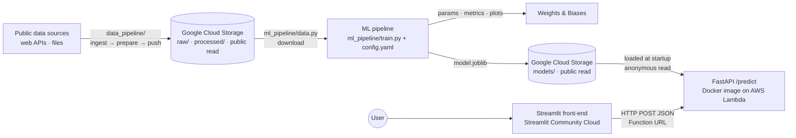

# &lt;Project Name&gt;

> 🚧 **Status: framework in place, dataset not chosen.** The pipeline, API, and Docker image are built and run end to end on a synthetic demo dataset ([try it](#0-try-it-on-the-demo-data)). Pointing them at the real dataset is a config change. Sections marked **TODO** get filled in once we pick it at kickoff. The stack is chosen: Google Cloud Storage for the data and models, AWS Lambda for the API, Weights & Biases, FastAPI, and Streamlit. See the [Development Plan](docs/DEVELOPMENT_PLAN.md) for the reasoning and the open decisions.

**TODO:** One-sentence pitch: what we predict, for whom, and why it's useful.

| | |
|---|---|
| 🖥️ **Live app** | TODO: `https://<app-name>.streamlit.app` |
| 🔌 **Prediction API** | TODO: `https://<url-id>.lambda-url.<region>.on.aws/predict` |
| 📖 **API docs (Swagger UI)** | TODO: `https://<url-id>.lambda-url.<region>.on.aws/docs` |
| 📈 **Experiment tracking** | TODO: `https://wandb.ai/<entity>/<project>` |

*AIPI 510, Module Project 3 (Data/ML Engineering), Duke University*
**Due:** Tuesday, November 24, 2026, 11:30 AM EST
**Team:** Haydn Stucker ([haydn-s](https://github.com/haydn-s)) · Jothi Gupta ([jothigup](https://github.com/jothigup))

---

## Table of Contents

- [\<Project Name\>](#project-name)
  - [Table of Contents](#table-of-contents)
  - [Project Overview](#project-overview)
  - [Architecture](#architecture)
  - [Dataset](#dataset)
  - [Problem Definition \& Evaluation](#problem-definition--evaluation)
  - [Model](#model)
  - [Cloud Services](#cloud-services)
  - [Language Choice: Python vs. Go](#language-choice-python-vs-go)
  - [Project Structure](#project-structure)
  - [Getting Started](#getting-started)
    - [Prerequisites](#prerequisites)
    - [Install](#install)
    - [The PyDev environment](#the-pydev-environment)
    - [Authenticate](#authenticate)
    - [Set up your .env](#set-up-your-env)
  - [Usage](#usage)
    - [0. Try it on the demo data](#0-try-it-on-the-demo-data)
    - [1. Build the dataset and upload it to the cloud](#1-build-the-dataset-and-upload-it-to-the-cloud)
    - [2. Train the model](#2-train-the-model)
    - [3. Run the API locally](#3-run-the-api-locally)
    - [4. Run everything with Docker](#4-run-everything-with-docker)
    - [5. Deploy the API to AWS Lambda](#5-deploy-the-api-to-aws-lambda)
    - [6. Run and deploy the front-end](#6-run-and-deploy-the-front-end)
  - [Configuration](#configuration)
  - [API Reference](#api-reference)
  - [Ethics, Limitations \& Responsible Use](#ethics-limitations--responsible-use)
  - [Contributing](#contributing)
    - [Commit messages](#commit-messages)
    - [Code style and the pre-PR check](#code-style-and-the-pre-pr-check)
    - [CI checks](#ci-checks)
    - [Branch protection](#branch-protection)
    - [Secret scanning](#secret-scanning)
    - [Dependency updates](#dependency-updates)
    - [Planned tooling](#planned-tooling)
  - [License \& Acknowledgments](#license--acknowledgments)

---

## Project Overview

**Problem.** TODO: What question does the model answer? Who would use it?

**Goals.** Build and deploy a reproducible, end-to-end ML system:

- Source a public dataset, clean it, and host it in cloud storage
- Train a model with a **config-driven, reproducible pipeline** that pulls data from the cloud
- **Track experiments** (parameters, metrics, plots, model artifacts)
- **Containerize** training and serving in a single Docker image
- Serve predictions from a **FastAPI `/predict` endpoint deployed to AWS Lambda** at a public HTTPS URL
- Ship a **public front-end** that calls the live API and presents its predictions in a clear, interactive way

**Non-goal.** State-of-the-art accuracy. This project is about engineering and MLOps practice. We keep the model simple on purpose.

## Architecture



## Dataset

| | |
|---|---|
| **Name** | TODO |
| **Source / link** | TODO |
| **License** | TODO (confirm it allows reuse and redistribution) |
| **Size** | TODO rows × TODO columns |
| **Target variable** | TODO |
| **Cloud location** | TODO: `gs://<bucket>/processed/<file>` (publicly readable) |

**Features used.**

| Feature | Type | Description |
|---|---|---|
| TODO | numeric / categorical | TODO |

**Cleaning & preprocessing.** TODO: missing-value handling, dropped columns and why, type fixes, outlier handling, leakage checks. Raw-to-processed cleaning, joining, and feature engineering happen in [`data_pipeline/prepare.py`](data_pipeline/prepare.py) ([Usage 1](#1-build-the-dataset-and-upload-it-to-the-cloud)). Model-time transforms (scaling, encoding) live in the training pipeline so the API can reuse them.

## Problem Definition & Evaluation

| | |
|---|---|
| **Task** | TODO: classification / regression |
| **Target** | TODO |
| **Primary metric** | TODO, e.g. F1 / ROC-AUC (classification) or RMSE / MAE (regression) |
| **Why this metric** | TODO |
| **Baseline** | TODO, e.g. majority class or mean prediction |
| **Split** | Train / validation / test with ratios set in `config.yaml` and a fixed random seed |

## Model

**Model.** TODO, e.g. a scikit-learn `Pipeline` with a `ColumnTransformer` (imputation + scaling + one-hot encoding) feeding a `RandomForestClassifier`. The full preprocessing + model pipeline is serialized as one artifact, so the API applies exactly the same transforms as training.

**Hyperparameters.** All hyperparameters are set in [`config.yaml`](config.yaml) (or a variant in [`configs/`](configs/)) and logged to W&B on every run. See [Configuration](#configuration).

**Results.**

| Model | Val metric | Test metric | W&B run |
|---|---|---|---|
| Baseline | TODO | TODO | TODO |
| TODO | TODO | TODO | TODO |

TODO: one paragraph on what worked, what didn't, and where the model fails (see [Ethics & Limitations](#ethics-limitations--responsible-use)).

## Cloud Services

| Service | Purpose |
|---|---|
| **Google Cloud Storage** | Bucket `climate-impact-pipeline-data` (project `climate-impact-pipeline`, `us-east1`) holds the raw snapshots, the processed dataset, and the trained models. It's publicly readable, so graders can rerun training and the API loads the model without Google credentials. Versioning is on |
| **Amazon ECR** | Stores the Docker image that Lambda runs |
| **AWS Lambda** | Runs the containerized FastAPI service at a public HTTPS Function URL, through the [AWS Lambda Web Adapter](https://github.com/awslabs/aws-lambda-web-adapter). Scales to zero when idle. Reads the model from Cloud Storage at startup. The bucket is public, so the function stores no cloud keys |
| **Weights & Biases** | Experiment tracking: parameters, metrics, plots, versioned model artifacts |
| **Streamlit Community Cloud** | Hosts the public front-end, deployed straight from this repo |
| **GitHub Actions** | CI checks on every pull request (see [CI checks](#ci-checks)) |

## Language Choice: Python vs. Go

We looked at Go for two reasons: it's widely used in industry, and this pipeline will be reused in a Deep Learning course in Spring 2027. **Decision: Python for this project and for the course. Go is worth learning for the serving and infrastructure layer, not for model development.**

**Where Go is the industry standard.** Go dominates cloud infrastructure. Docker, Kubernetes, Terraform, and Prometheus are all written in it. It's also growing in ML *infrastructure*: Ollama's server is mostly Go, and the W&B Python SDK ships a Go core service. Model *development* (training, research, experimentation) is still overwhelmingly Python. PyTorch, TensorFlow/Keras, JAX, scikit-learn, and Hugging Face are all Python-first.

### Ecosystem (snapshot, November 2026)

| Need | Python | Go |
|---|---|---|
| Arrays and numerics | NumPy, SciPy | gonum (active) |
| DataFrames | pandas | No maintained equivalent (gota is archived) |
| Classical ML | scikit-learn, XGBoost, statsmodels | GoLearn (no commits since January 2024). Otherwise, write it yourself |
| Deep learning | PyTorch, TensorFlow/Keras, JAX | GoMLX (active: XLA backend for CPU/GPU/TPU, plus pure-Go and ONNX backends). Gorgonia (inactive since 2024) and the gotch libtorch bindings (inactive since early 2025) |
| Pretrained models | Hugging Face, torchvision, Keras | Load ONNX exports through ONNX Runtime (onnxruntime_go, active) |
| Notebooks and plots | Jupyter, matplotlib, seaborn, plotly | GoNB (a Go kernel for Jupyter), gonum/plot |
| Experiment tracking | Official W&B and MLflow SDKs | No official client libraries. Call their HTTP APIs directly |
| Serving an API | FastAPI, Flask | Standard library `net/http`. Excellent |
| Front-end | Streamlit, Gradio | None. You'd build a separate web app |

### Feasibility

- **This project.** The assignment names FastAPI or Flask for the API, Streamlit/Gradio/NextJS for the front-end, MLflow or W&B for tracking, and `requirements.txt` or `environment.yaml` for dependencies. The required parts have to be Python, so Go could only be an *extra*.
- **Training in Go.** Possible, but we'd hand-write the preprocessing that scikit-learn pipelines give us for free, and we'd lose the W&B SDK.
- **Serving in Go.** The most realistic use. Export the trained scikit-learn pipeline to ONNX with `skl2onnx`, then serve it from a Go `net/http` service using ONNX Runtime. The catch: ONNX Runtime is a C library, so the Go build needs cgo, and the Docker image needs the library.
- **The Deep Learning course.** Course materials, assignments, and pretrained models will be in PyTorch or TensorFlow. Working in Go would mean translating every example. GoMLX makes it possible, but we'd be early adopters with few examples to learn from.

### Learning curve

| | Python | Go |
|---|---|---|
| The language | We already know it | Small and quick to learn: 25 keywords, one standard formatter (`gofmt`), fast compiles, static types. Expect days to a few weeks to become productive |
| ML in that language | Huge ecosystem of tutorials, Q&A, and course material | Steep. Few examples, no notebook-first culture, and native libraries need cgo, which complicates builds |
| Day-to-day friction | Environment and package management (handled here by PyDev and `make venv`). Type errors show up only at runtime | Verbose explicit error handling. More code for exploratory work |

### Anticipated performance

Most ML computation doesn't run in Python at all. NumPy, pandas, scikit-learn, PyTorch, and TensorFlow hand the heavy work to optimized C, C++, and CUDA code, so the calling language matters less than you'd expect.

| Workload | Likely faster | Why |
|---|---|---|
| Model training, especially on GPU | Python, or a tie at best | Both end up in native kernels, and Python's GPU support (CUDA, Apple MPS) is far more mature |
| Vectorized data prep | Tie | NumPy and pandas operations already run in C |
| Hand-written loops over rows | Go, often by an order of magnitude or more | Compiled vs. interpreted. Vectorizing the Python version closes most of the gap |
| API latency at our traffic (a class demo) | Tie | Model inference dominates request time |
| API throughput and memory under heavy load | Go | Goroutines handle many concurrent requests in one lightweight process. Python servers scale by adding worker processes |
| Container size and cold start | Go | A plain Go service compiles to one binary, so images can be tens of MB (ONNX Runtime adds its library). Python plus ML libraries runs from hundreds of MB to several GB. This matters most on serverless platforms that start containers on demand |
| Speed of experimenting | Python | Notebooks, libraries, examples |

### Recommendation

Keep Python as the project language. For hands-on Go experience without risking the deadline, the best fit is an **optional stretch goal**, once everything required is done:

1. Export our model to ONNX.
2. Write a small Go service that serves the same `/predict` request and response.
3. Deploy it next to the FastAPI service.
4. Load-test both (e.g., with [`hey`](https://github.com/rakyll/hey) or [k6](https://k6.io/)) and compare latency, throughput, memory, image size, and cold start.

That turns the table above into measured numbers. It's listed as a stretch task in the [Development Plan](docs/DEVELOPMENT_PLAN.md#stretch-optional-go-inference-service).

## Project Structure

```
.
├── config.yaml              # All parameters, in three parts: shared, data pipeline, ML pipeline
├── configs/                 # Experiment variants that extend config.yaml (baseline, linear, ...)
├── requirements.txt         # Pipeline + API runtime dependencies (pinned; used by Docker, CI, PyDev)
├── requirements-dev.txt     # Dev tooling: pre-commit, pytest, httpx2
├── requirements-pydev.txt   # PyDev environment: adds notebooks and deep learning (local only)
├── pyproject.toml           # Shared code style (ruff) and pytest settings
├── Makefile                 # Dev commands, grouped by pipeline (run `make help`)
├── Dockerfile               # One image with `train` and `serve` entry points. Also runs on Lambda
├── entrypoint.sh            # Dispatches `train` | `serve` | any other command
├── .dockerignore            # Keeps data, models, secrets, and PyDev out of the image
├── .env.example             # Environment variables to copy into .env (no secrets committed)
├── .commitlintrc.yaml       # Commit message rules (Conventional Commits)
├── .pre-commit-config.yaml  # Local git hooks: commitlint, gitleaks, ruff, file checks
├── .github/
│   ├── workflows/ci.yml     # CI checks run on every PR
│   ├── rulesets/            # Branch protection for main, kept as code
│   ├── CODEOWNERS           # Auto-requests partner review on every PR
│   ├── dependabot.yml       # Weekly dependency update PRs
│   └── pull_request_template.md
├── shared/                  # Used by both pipelines and the API
│   ├── config.py            # Load + validate config files (extends:, --set overrides)
│   ├── storage.py           # Copy files to and from Cloud Storage (anonymous reads of public files)
│   ├── tables.py            # Read/write CSV and Parquet; check a table has the config's columns
│   └── cli.py               # --config/--set options, .env loading, and logging for every command
├── data_pipeline/           # Data pipeline: sources → processed table in Cloud Storage
│   ├── ingest.py            # 1/3: fetch each source (file, http, custom types) → raw snapshots
│   ├── prepare.py           # 2/3: cleaners, joins, and feature steps → processed table
│   └── push.py              # 3/3: upload the processed table (the hand-off to the ML pipeline)
├── ml_pipeline/             # ML pipeline: processed table → trained model
│   ├── data.py              # Download the processed table, train/validation/test split
│   ├── features.py          # Preprocessing (sklearn ColumnTransformer)
│   ├── models.py            # model.type → scikit-learn estimator
│   ├── evaluate.py          # Metrics + plots
│   ├── tracking.py          # W&B logging
│   ├── train.py             # Entry point: load → split → train → evaluate → log → save
│   └── demo_data.py         # Synthetic dataset for trying the pipeline before we pick one
├── api/
│   ├── main.py              # FastAPI app: /health, /metadata, /predict
│   └── schemas.py           # Response models. The request model is built from the model's metadata
├── frontend/                # Planned (task B5)
│   ├── app.py               # Streamlit UI that calls the deployed API
│   └── requirements.txt     # Front-end-only dependencies (used by Streamlit Cloud)
├── scripts/
│   └── docker_smoke_test.sh # Trains and serves inside the image (make docker-smoke, CI)
├── tests/                   # Mirrors the packages: shared/, data_pipeline/, ml_pipeline/, api/
│   ├── test_layout.py       # Each package imports only what it may (the pipelines never import each other)
│   └── sample_request.json  # Example payload for curl / Postman
├── notebooks/               # Planned (task A1)
│   └── eda.ipynb            # Exploration only; the pipeline never depends on notebooks
└── docs/
    └── DEVELOPMENT_PLAN.md
```

**Two pipelines, one hand-off.** `data_pipeline/` and `ml_pipeline/` are separate packages that never import each other (`tests/test_layout.py` enforces it). The data pipeline's only output is the processed table at `data.remote_uri`, and that table is the ML pipeline's only input. Both use `shared/` and read the same `config.yaml`, whose shared section (`data` and `features`) is the contract between them: `make push` refuses a table that doesn't match it.

## Getting Started

### Prerequisites

- [uv](https://docs.astral.sh/uv/) (recommended, and it installs Python 3.12 for you) or Python 3.12
- `make` (preinstalled on macOS and Linux. On Windows, use WSL or Git Bash)
- [Node.js](https://nodejs.org/) 22.12+ (`make pr-ready` uses it to run commitlint)
- [Docker](https://docs.docker.com/get-docker/)
- The [Google Cloud CLI](https://cloud.google.com/sdk/docs/install) and access to project `climate-impact-pipeline`, to upload data and models. Not needed just to train: the processed data is publicly readable
- The [AWS CLI v2](https://docs.aws.amazon.com/cli/latest/userguide/getting-started-install.html) and a login to our AWS account (ask the account owner), to deploy the API to Lambda
- A [Weights & Biases](https://wandb.ai/) account (W&B is now part of CoreWeave Forge). Students can apply for the free academic plan with a university email. Not needed just to train: set `WANDB_MODE=disabled`

### Install

```bash
git clone git@github.com:haydn-s/sourcing-data-project-3.git
cd sourcing-data-project-3
make venv              # creates PyDev (Python 3.12) and installs requirements-pydev.txt
source PyDev/bin/activate
make setup             # installs the git hooks: commitlint, gitleaks, ruff, file checks
cp .env.example .env   # then fill in what you need (Set up your .env)
```

`make venv` uses uv if it's installed, and falls back to `python3.12 -m venv`. Without `make`:

```bash
uv venv --seed --python 3.12 PyDev   # or: python3.12 -m venv PyDev
source PyDev/bin/activate            # Windows: PyDev\Scripts\activate
pip install -r requirements-pydev.txt
pre-commit install
```

`pre-commit install` is required once per clone. Without it, problems aren't caught until CI fails on your PR. The first commit afterward takes a minute or two while pre-commit builds the hook tools; after that, hooks run in seconds.

### The PyDev environment

PyDev is our shared local environment for data science and deep learning work (Python 3.12). It's defined in [`requirements-pydev.txt`](requirements-pydev.txt), which includes [`requirements.txt`](requirements.txt) (the pipeline and API, plus google-cloud-storage, FastAPI, and Uvicorn), with every version pinned:

| Area | Libraries |
|---|---|
| Numerics and data | numpy, pandas, scipy, pyarrow |
| Statistics and classical ML | statsmodels, scikit-learn, xgboost |
| Deep learning | torch, torchvision, tensorflow (includes Keras) |
| Visualization | matplotlib, seaborn, plotly, shap |
| Notebooks | jupyterlab, ipykernel, ipywidgets |
| Tracking and utilities | wandb, pyyaml, python-dotenv, tqdm |
| Pipeline and serving | google-cloud-storage, requests, FastAPI, Uvicorn, pydantic (from `requirements.txt`) |
| Dev tooling | pre-commit, pytest, httpx2 (from `requirements-dev.txt`) |

To use PyDev from Jupyter or VS Code notebooks, register it as a kernel once:

```bash
python -m ipykernel install --user --name PyDev
```

**Hardware notes.** On Apple Silicon, PyTorch can use the GPU through MPS (`torch.backends.mps.is_available()`), while TensorFlow runs on the CPU unless you add Apple's optional `tensorflow-metal` plugin. torch 2.12 and newer need macOS 14 or later.

**Requirements files.** Each environment installs only what it needs:

| File | Installed by | Contents |
|---|---|---|
| `requirements.txt` | Docker image, CI, PyDev | Runtime dependencies for the pipeline and API |
| `requirements-dev.txt` | CI, PyDev | pre-commit, pytest, httpx2 |
| `requirements-pydev.txt` | PyDev (local only) | Both files above, plus notebooks, extra plotting, and deep learning |
| `frontend/requirements.txt` | Streamlit Community Cloud | Front-end only (added with the front-end) |

Keeping torch and TensorFlow out of `requirements.txt` keeps the API's Docker image and CI runs small. Shared packages are pinned only in `requirements.txt`, so PyDev and the image always match. That matters most for scikit-learn: a model saved with one version may not load in another, and the API logs a warning when they differ.

### Authenticate

```bash
wandb login
```

Sign in to Google Cloud so the pipeline can upload data and models to Cloud Storage. The second command saves Application Default Credentials, which the Python client uses:

```bash
gcloud config set project climate-impact-pipeline
```

```bash
gcloud auth application-default login
```

Reading the public bucket needs no login, so anyone can train without these.

To deploy the API, set up an AWS CLI profile. Use the first command if the account uses IAM Identity Center, or the second if you have an IAM user's access keys:

```bash
aws configure sso --profile project3
```

```bash
aws configure --profile project3
```

Check which account and role you're signed in as:

```bash
aws sts get-caller-identity --profile project3
```

The deploy commands in [Usage 5](#5-deploy-the-api-to-aws-lambda) use this profile. With Identity Center, run `aws sso login --profile project3` when your session expires.

### Set up your `.env`

Settings that aren't secret live in `config.yaml`. Secrets and per-machine values go in `.env`, which git ignores. Start from the template:

```bash
cp .env.example .env
```

What you fill in depends on what you run. Nobody needs every value.

**Data pipeline** (`make ingest`, `make prepare`, `make push`):

1. Keep `GOOGLE_CLOUD_PROJECT=climate-impact-pipeline`.
2. Sign in to Google Cloud ([Authenticate](#authenticate)) so `make ingest` and `make push` can upload.
3. Uncomment and fill in a key for each source in `ingest.sources` that needs one ([below](#data-source-keys)). `make ingest` lists any that are missing, or left blank, before it fetches anything.

**ML pipeline and API** (`make train`, `make serve`):

1. Run `wandb login`, or set `WANDB_API_KEY`. To train without a W&B account, set `WANDB_MODE=disabled` instead.
2. Leave `MODEL_URI` as is to serve your latest local model, or set it to `gs://climate-impact-pipeline-data/models/latest/model.joblib` to serve the published one.
3. That's all to train: training downloads the processed data from the public bucket, so it needs no data-source keys and no Google login.
4. To upload models (once `output.remote_prefix` is set in `config.yaml`), sign in to Google Cloud ([Authenticate](#authenticate)). The bucket's owner first grants your Google account write access, once:

    ```bash
    gcloud storage buckets add-iam-policy-binding gs://climate-impact-pipeline-data --member=user:name@example.com --role=roles/storage.objectAdmin
    ```

    Replace `name@example.com` with your Google account's email.

**Front-end:** set `API_URL` to the API you're calling.

#### Data source keys

Each is free, and everyone requests their own. In `config.yaml`, a source refers to its key as `${NAME}`:

| Variable | Source | Get one at | In the source's config |
|---|---|---|---|
| `NASS_API_KEY` | USDA NASS Quick Stats: bee colonies, crops | [quickstats.nass.usda.gov/api](https://quickstats.nass.usda.gov/api) | `params: {key: "${NASS_API_KEY}"}` |
| `NOAA_CDO_TOKEN` | NOAA Climate Data Online: weather station records | [ncdc.noaa.gov/cdo-web/token](https://www.ncdc.noaa.gov/cdo-web/token) | `headers: {token: "${NOAA_CDO_TOKEN}"}` |
| `EIA_API_KEY` | EIA Open Data: power plants, electricity | [eia.gov/opendata/register.php](https://www.eia.gov/opendata/register.php) | `params: {api_key: "${EIA_API_KEY}"}` |
| `EARTHDATA_TOKEN` | NASA Earthdata: GRACE ice mass (PO.DAAC) | **Generate Token** on your profile at [urs.earthdata.nasa.gov](https://urs.earthdata.nasa.gov) | `headers: {Authorization: "Bearer ${EARTHDATA_TOKEN}"}`. Tokens expire, and some NASA hosts don't take them, so check the dataset's access page |

These sources need no key: Open-Meteo (sunshine and weather), NASA POWER (solar irradiance), NOAA Climate at a Glance (state climate), the USGS earthquake catalog, the NSIDC Sea Ice Index, BTS flight data, and the GEM active faults database.

If a key ever lands in a response, ingest replaces it with `***` before saving the snapshot, since snapshots are uploaded to the public bucket. Error messages hide keys too.

#### All variables

| Variable | Used by | Description |
|---|---|---|
| `GOOGLE_CLOUD_PROJECT` | data pipeline | Our Google Cloud project, `climate-impact-pipeline` |
| `NASS_API_KEY`, `NOAA_CDO_TOKEN`, `EIA_API_KEY`, `EARTHDATA_TOKEN` | data pipeline | Data source keys ([above](#data-source-keys)) |
| `WANDB_API_KEY` | ML pipeline | W&B API key (or run `wandb login`) |
| `WANDB_MODE` | ML pipeline | Optional. `offline` or `disabled` lets you train without a W&B account |
| `MODEL_URI` | API | Model location: `gs://climate-impact-pipeline-data/models/latest/model.joblib` or a local path (default: `models/latest/model.joblib`) |
| `MODEL_CACHE_DIR` | API | Optional. Where a Cloud Storage model is downloaded (default: a folder in `/tmp`, the only writable path on Lambda) |
| `API_URL` | front-end | Base URL of the deployed API (the Lambda Function URL) |

## Usage

Run these from the repo root, inside PyDev (`source PyDev/bin/activate`).

### 0. Try it on the demo data

Until we pick a dataset, `config.yaml` points at a synthetic customer-churn dataset (made-up rows, no real people). This runs the whole pipeline locally, with no cloud or W&B account:

```bash
make demo-data
```

```bash
WANDB_MODE=disabled make train
```

```bash
make serve
```

Then open <http://localhost:8080/docs>, or send the sample request from another terminal:

```bash
curl -X POST http://localhost:8080/predict -H "Content-Type: application/json" -d @tests/sample_request.json
```

### 1. Build the dataset and upload it to the cloud

The data pipeline has three stages, each its own script. Run them all with `make data`, or one at a time:

```bash
make ingest
```

```bash
make prepare
```

```bash
make push
```

1. **Ingest** ([`data_pipeline/ingest.py`](data_pipeline/ingest.py)) fetches every source in `ingest.sources` and saves its rows unchanged to `data/raw/<name>.csv`, with a `manifest.json` recording when and where each came from. Sources are files (local, URL, or `gs://`) or web APIs (`type: http`, JSON or CSV). APIs that need paging get a custom type registered in the same file. With `ingest.remote_prefix` set, the snapshots are uploaded too. Add `--source NAME` to refetch just one.
2. **Prepare** ([`data_pipeline/prepare.py`](data_pipeline/prepare.py)) cleans each snapshot, joins the sources on their `join_on` columns, runs the feature steps in `prepare.feature_steps`, and writes `data.local_path`. Every source gets a standard clean (snake_case columns, trimmed text, no empty or duplicate rows). Its own cleaner, and the feature steps, are functions registered in the same file. The joins check for the usual mistakes: missing keys, mismatched key types, and keys that would duplicate rows.
3. **Push** ([`data_pipeline/push.py`](data_pipeline/push.py)) uploads the processed table to `data.remote_uri`. It refuses a table that lacks the config's features or target, since training on it would fail.

The ML pipeline then downloads `data.remote_uri` with [`ml_pipeline/data.py`](ml_pipeline/data.py). Because the bucket is publicly readable, that needs no Google login. The file is also at `https://storage.googleapis.com/climate-impact-pipeline-data/processed/<file>`.

### 2. Train the model

```bash
make train
```

That runs `python -m ml_pipeline.train --config config.yaml`. It downloads the processed data from cloud storage (when `data.remote_uri` is set), splits it, trains, evaluates on the validation and test sets, logs everything to W&B, and saves the model pipeline locally and, when `output.remote_prefix` is set, to `gs://climate-impact-pipeline-data/models/`.

Each run writes `models/<run-id>/` and copies it to `models/latest/`:

| File | Contents |
|---|---|
| `model.joblib` | The fitted scikit-learn pipeline: preprocessing plus model |
| `metadata.json` | Run ID, metrics, features (with ranges and categories), class labels, data hash, library versions, and the full config. The API builds its request schema from this file |
| `plots/` | Confusion matrix (classification) or predicted-vs-actual and residuals (regression), plus feature importance |

**Experiments.** Train a variant from [`configs/`](configs/), or override single values:

```bash
make train CONFIG=configs/baseline.yaml
```

```bash
python -m ml_pipeline.train --config config.yaml --set model.params.max_depth=5 --set split.test_size=0.2
```

**Without our accounts.** Training still runs without Google Cloud credentials (the processed data is public, and the model is saved locally only) or a W&B account:

```bash
WANDB_MODE=disabled make train
```

### 3. Run the API locally

```bash
make serve
```

That runs `uvicorn api.main:create_app --factory --reload --port 8080`, serving `models/latest/model.joblib`. Set `MODEL_URI` to serve another model, including one in Cloud Storage. The app is created by a factory because its request schema comes from the model it loads.

```bash
curl http://localhost:8080/health
```

```bash
curl -X POST http://localhost:8080/predict \
  -H "Content-Type: application/json" \
  -d @tests/sample_request.json
```

Interactive docs: <http://localhost:8080/docs>

### 4. Run everything with Docker

Build the image. `make docker-build` builds for `linux/amd64` without attestations, which is what Lambda needs, so the same image runs locally and in the cloud:

```bash
make docker-build
```

Mounting `data/` and `models/` keeps the data and trained models on your machine. Training reads the public bucket with no login. To upload models from the container, also mount your Google credentials with `-v "$HOME/.config/gcloud:/root/.config/gcloud:ro"`.

Train inside the container (arguments after `train` go to `ml_pipeline.train`):

```bash
docker run --rm --env-file .env -v "$PWD/data:/app/data" -v "$PWD/models:/app/models" project3 train
```

Serve the API (the default command) on port 8080:

```bash
docker run --rm -p 8080:8080 --env-file .env -v "$PWD/models:/app/models" project3
```

**Smoke test.** This builds the image, generates the demo data and trains inside it, then serves the model the way Lambda runs it (a non-root user and a read-only filesystem except `/tmp`) and calls `/health` and `/predict`. CI runs it on every PR:

```bash
make docker-smoke
```

### 5. Deploy the API to AWS Lambda

> Planned steps. We'll confirm the exact commands during task B4.

Set a few shell variables first, replacing the region if needed:

```bash
export AWS_PROFILE=project3 AWS_REGION=us-east-1 FUNCTION=project3-api REPO=project3-api
export REGISTRY="$(aws sts get-caller-identity --query Account --output text).dkr.ecr.$AWS_REGION.amazonaws.com"
export IMAGE="$REGISTRY/$REPO:latest"
```

**1. Build the image.** Lambda accepts only a single-platform image without buildx's default attestations, so build it this way on every machine, Apple Silicon included:

```bash
make docker-build IMAGE="$IMAGE"
```

**2. Push it to ECR.** Create the repository the first time only:

```bash
aws ecr create-repository --repository-name "$REPO"
```

Then sign Docker in to ECR and push:

```bash
aws ecr get-login-password | docker login --username AWS --password-stdin "$REGISTRY"
docker push "$IMAGE"
```

**3. Create the function (first time only).** In the Lambda console, choose **Create function → Container image**, pick the image, and set the architecture to **x86_64**. Then, under **Configuration**:

- **General configuration:** memory 2048 MB, timeout 30 seconds
- **Environment variables:** `MODEL_URI=gs://climate-impact-pipeline-data/models/latest/model.joblib`. The bucket is public, so the function needs no Google credentials or extra permissions to read it
- **Function URL:** create one with auth type **NONE**. The console adds both permissions a public URL needs (`lambda:InvokeFunctionUrl` and `lambda:InvokeFunction`)

**4. Deploy later changes.** Rebuild and push (steps 1 and 2), then point the function at the new image:

```bash
aws lambda update-function-code --function-name "$FUNCTION" --image-uri "$IMAGE"
```

Confirm the deployed endpoint works. The first request after the function sits idle takes a few extra seconds (a cold start):

```bash
curl -X POST https://<url-id>.lambda-url.<region>.on.aws/predict \
  -H "Content-Type: application/json" \
  -d @tests/sample_request.json
```

### 6. Run and deploy the front-end

Locally:

```bash
pip install -r frontend/requirements.txt
API_URL=http://localhost:8080 streamlit run frontend/app.py
```

Deploy on [Streamlit Community Cloud](https://share.streamlit.io/): **New app** → this repo → branch `main` → main file `frontend/app.py`. Then under **Advanced settings → Secrets**, add:

```toml
API_URL = "https://<url-id>.lambda-url.<region>.on.aws"
```

## Configuration

Every pipeline parameter lives in [`config.yaml`](config.yaml), which documents each setting inline. The code holds nothing dataset-specific. Configs are validated when they load, so a typo or an impossible setting (a metric that doesn't fit the task, split sizes that leave no training rows) fails with a clear message before training starts.

| Section | What it controls |
|---|---|
| `seed` | Random seed for the split and the model |
| `task` | `classification` or `regression` |
| `data` | Where the processed data lives (`remote_uri` in Cloud Storage, cached at `local_path`) and the `target` column |
| `ingest` | The data `sources` (type, location, parameters, join keys), the raw snapshot folder, and where to upload snapshots |
| `prepare` | The feature steps to run after cleaning and joining |
| `features` | The `numeric` and `categorical` columns to use. Other columns are ignored |
| `split` | Test and validation fractions (of the whole dataset), stratification for classification, and `time_column` to split by time instead (the latest rows become the test set) |
| `model` | `type` (below) and `params`, passed straight to the scikit-learn estimator |
| `evaluation` | `primary_metric`: `accuracy`, `f1` (macro), or `roc_auc` for classification; `rmse`, `mae`, or `r2` for regression |
| `tracking` | W&B `project`, `entity` (team), and `tags` |
| `output` | Local model folder and the Cloud Storage prefix to upload models to |

**Model types.** Each type works for both tasks, so switching tasks doesn't mean renaming the model. Add more in [`ml_pipeline/models.py`](ml_pipeline/models.py).

| `model.type` | Classification | Regression |
|---|---|---|
| `dummy` | `DummyClassifier` (most common class) | `DummyRegressor` (mean) |
| `linear` | `LogisticRegression` | `Ridge` |
| `random_forest` | `RandomForestClassifier` | `RandomForestRegressor` |
| `hist_gradient_boosting` | `HistGradientBoostingClassifier` | `HistGradientBoostingRegressor` |
| `xgboost` | `XGBClassifier` | `XGBRegressor` (needs xgboost in `requirements.txt` first) |

**Variants.** A file in [`configs/`](configs/) starts with `extends: ../config.yaml` and lists only what changes. Sections merge key by key, except `model.params`, which is replaced as a whole so each variant lists exactly the hyperparameters it uses. `--set key.path=value` overrides a single value from the command line. Values are read as YAML, so `5`, `true`, and `[a, b]` work.

**Switching to the real dataset:**

1. Add the sources to `ingest.sources`, write their cleaners and any feature steps in [`data_pipeline/prepare.py`](data_pipeline/prepare.py), and run `make data` ([Usage 1](#1-build-the-dataset-and-upload-it-to-the-cloud)).
2. In `config.yaml`, set `task`, the `data` section, `features`, and `evaluation.primary_metric`. Update `tracking.tags`.
3. Replace [`tests/sample_request.json`](tests/sample_request.json) with a real record. The API tests and the Docker smoke test send it.
4. Delete `ml_pipeline/demo_data.py` and the `demo-data` make target once nothing uses them.

## API Reference

| Method | Path | Description |
|---|---|---|
| `GET` | `/health` | Liveness check; returns model version. Lambda's readiness check calls it too |
| `GET` | `/metadata` | The model's features (numeric ranges, allowed categories), class labels, test metrics, and an example request. The front-end can build its form from this |
| `POST` | `/predict` | Returns a prediction for one input record |
| `GET` | `/docs` | Auto-generated Swagger UI (`/` redirects here) |

The `/predict` request schema is generated from the served model's `metadata.json`, so it always matches the model: one field per feature, categorical fields limited to the categories seen in training, and unknown fields rejected. Invalid requests get a `422` that says which field is wrong.

**Example request** (the demo dataset; TODO: replace with real features):

```json
{
  "age": 34,
  "monthly_spend": 49.5,
  "support_calls": 3,
  "region": "south",
  "plan": "standard"
}
```

**Example response.** `probability` is the predicted class's probability (`null` for regression), and `model_version` is the W&B run ID:

```json
{
  "prediction": "yes",
  "probability": 0.79,
  "model_version": "nmbwlftk"
}
```

## Ethics, Limitations & Responsible Use

TODO: fill this in once we choose the dataset. Questions to answer:

- **Data provenance & consent:** Who collected the data, when, and for what purpose? Does using it this way match that purpose?
- **Representativeness & bias:** Which populations, regions, or time periods are over- or under-represented? Does the data include sensitive attributes (directly or through proxies), and how does performance differ across subgroups?
- **Intended use & misuse:** What decisions should this model *not* be used for? What happens when a prediction is wrong, and who bears the cost?
- **Limitations:** Dataset age, distribution shift, small sample sizes, metric trade-offs, features we couldn't capture.
- **Privacy:** Does the dataset contain personal information? Does the API log user inputs?
- **Transparency in the UI:** The front-end shows a confidence score and a short disclaimer, so users don't over-trust the output.

## Contributing

All work goes through **feature branches and pull requests** into `main`. See the [Development Plan](docs/DEVELOPMENT_PLAN.md#8-git-workflow) for branch naming and the PR checklist.

### Commit messages

Commits follow [Conventional Commits](https://www.conventionalcommits.org/), enforced by [commitlint](https://commitlint.js.org/) with the rules in [`.commitlintrc.yaml`](.commitlintrc.yaml):

```
<type>(<optional scope>): <lowercase summary>

feat(api): add /predict endpoint
fix(data): handle missing values in age column
docs: add dataset description to README
```

Allowed types: `feat`, `fix`, `docs`, `style`, `refactor`, `perf`, `test`, `build`, `ci`, `chore`, `revert`. Suggested scopes: `data`, `pipeline`, `api`, `frontend`, `docker`, `deploy`, `deps`.

commitlint runs in two places:

- **Locally**, as a `commit-msg` git hook installed by `pre-commit install`. It rejects bad messages before the commit is created.
- **In CI**, on every commit in a PR *and* on the PR title.

### Code style and the pre-PR check

Our code style lives in [`pyproject.toml`](pyproject.toml), so the hooks, CI, and editors all apply the same rules:

- **Formatter:** `ruff format`, 100-character lines, double quotes
- **Linter:** `ruff check` with pycodestyle, pyflakes, import sorting, bugbear (likely bugs), pyupgrade, naming, simplify, comprehensions, NumPy, and ruff's own rules. sklearn-style names like `X_train` are allowed
- To change the style, edit `pyproject.toml` in a PR

**Before opening a PR, run:**

```bash
make pr-ready PR_TITLE="feat(api): add /predict endpoint"
```

It stops at the first failure. It checks that:

1. You're not on `main`, and the git hooks are installed
2. You have no uncommitted changes and your branch isn't behind `main` (warnings only)
3. Every pre-commit hook passes on all files (`make lint`)
4. The tests pass (`make test`)
5. Every commit on your branch, and the PR title if you pass one, follows Conventional Commits

Passing locally means CI should pass too. The one check CI adds is a gitleaks scan of every commit in the PR; locally, gitleaks runs on each commit through the hook. `make format` auto-fixes what it can.

| Command | What it does |
|---|---|
| `make venv` | Create or update the PyDev environment |
| `make setup` | Install dev tooling and git hooks (run inside PyDev) |
| `make format` | Auto-fix formatting and lint issues in all files |
| `make lint` | Run every pre-commit hook on all files |
| `make test` | Run the tests |
| `make demo-data` | Generate the synthetic demo dataset |
| `make data` | Run the data pipeline: `make ingest`, `make prepare`, `make push` |
| `make train CONFIG=...` | Train a model (default: `config.yaml`) |
| `make serve` | Run the API locally with auto-reload |
| `make docker-build` | Build the image for Lambda (`linux/amd64`) |
| `make docker-smoke` | Build the image, train and serve inside it, and call the API |
| `make lint-commits` | Lint the commit messages on your branch |
| `make lint-title PR_TITLE="..."` | Lint a PR title |
| `make pr-ready` | Everything above, before you open a PR |

### CI checks

[`.github/workflows/ci.yml`](.github/workflows/ci.yml) runs on every pull request and every push to `main`:

| Job | What it checks |
|---|---|
| **Commit messages & PR title** | commitlint on each commit in the PR and on the PR title |
| **Secret scan (gitleaks)** | Scans every commit in the PR for API keys, tokens, and private keys |
| **Lint (pre-commit hooks)** | `make lint`: file checks (large files, whitespace, YAML/JSON/TOML syntax) plus ruff lint and format |
| **Tests (pytest)** | `make test`: config validation, preprocessing, models, storage, training end to end, and the API |
| **Docker image (build + smoke test)** | `make docker-smoke`: builds the image, trains on the demo data inside it, and calls the API under Lambda-like conditions |
| **CI passed** | Gate job that succeeds only if every job above passed or was skipped. Branch protection requires this one check |

To add a check, add a job to `ci.yml` and list it under `ci-passed.needs`. Branch protection doesn't need to change. Planned addition: a deploy job on merge that pushes the image to ECR and updates the Lambda function.

CI calls the same `make` targets you run locally. See [Code style and the pre-PR check](#code-style-and-the-pre-pr-check).

### Branch protection

`main` is protected by a repository ruleset, kept as code in [`.github/rulesets/protect-main.json`](.github/rulesets/protect-main.json):

- No direct pushes, force pushes, or deletion. Every change goes through a pull request
- At least **1 approving review** from a collaborator with write access. You can't approve your own PR, so your partner reviews it
- Approvals are dismissed when new commits are pushed
- All review conversations must be resolved
- The **CI passed** check must succeed
- **Squash merge only.** Each PR becomes one commit on `main`, titled with the PR title, so `main` history follows Conventional Commits. Merged branches are deleted automatically
- No bypass, admins included

[`.github/CODEOWNERS`](.github/CODEOWNERS) lists both of us, so GitHub automatically requests a review from whoever didn't open the PR.

### Secret scanning

We check for leaked credentials (cloud keys, W&B API keys, tokens) at several points:

| Where | When | Tool |
|---|---|---|
| Your machine | `git commit` | gitleaks pre-commit hook. Blocks the commit, so the secret never enters git history |
| GitHub | `git push` | GitHub push protection. Rejects pushes containing known provider token formats |
| CI | Every PR | gitleaks scans each commit in the PR. A finding fails **CI passed** and blocks the merge |
| GitHub | Always | GitHub secret scanning. Watches the full history and raises alerts in the **Security** tab |

**If a secret leaks, revoke or rotate it at the provider first.** Deleting it from the code doesn't help, because it stays in git history and may already have been copied. For a false positive, add `# gitleaks:allow` to the end of the line.

### Dependency updates

[Dependabot](.github/dependabot.yml) opens weekly PRs that update pip packages, the Docker base images, GitHub Actions, and pre-commit hooks, plus PRs for security fixes. They go through the same CI and review as any other PR.

### Planned tooling

These are deferred until the code exists:

- **Editor format-on-save.** Shared `.vscode/settings.json` and `extensions.json` that install the Ruff extension and format on save, once we confirm we both use VS Code or Cursor. Until then, `make format` does the same job.
- **Project-specific checks as pre-commit hooks.** Small scripts in `scripts/hooks/` that pre-commit runs on every commit. For example:
  - Every feature in `config.yaml` appears in the API's request schema (after task B1)
  - Notebooks are committed with outputs cleared (once `notebooks/` has content)

## License & Acknowledgments

Licensed under the [Apache License 2.0](LICENSE).

TODO: dataset citation and any other acknowledgments.
