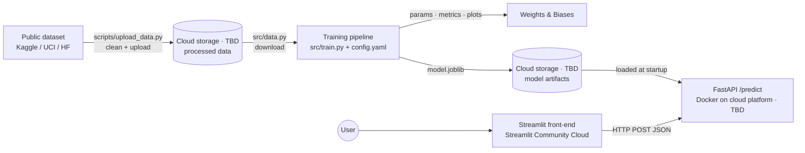

# &lt;Project Name&gt;

> 🚧 **Status: planning.** We haven't picked the dataset or the problem yet; we'll decide at kickoff. Sections marked **TODO** get filled in as we build. The stack described here is our *proposed default*; see the [Development Plan](docs/DEVELOPMENT_PLAN.md) for the reasoning and the open decisions.

**TODO:** One-sentence pitch: what we predict, for whom, and why it's useful.

| | |
|---|---|
| 🖥️ **Live app** | TODO: `https://<app-name>.streamlit.app` |
| 🔌 **Prediction API** | TODO: `https://<api-host>/predict` |
| 📖 **API docs (Swagger UI)** | TODO: `https://<api-host>/docs` |
| 📈 **Experiment tracking** | TODO: `https://wandb.ai/<entity>/<project>` |

*AIPI 510, Module Project 3 (Data/ML Engineering), Duke University*
**Team:** Haydn Stucker ([haydn-s](https://github.com/haydn-s)) · Jothi Gupta ([jothigup](https://github.com/jothigup))

---

## Table of Contents

- [\<Project Name\>](#project-name)
  - [Table of Contents](#table-of-contents)
  - [Project Overview](#project-overview)
  - [Architecture](#architecture)
  - [Dataset](#dataset)
  - [Problem Definition \& Evaluation](#problem-definition--evaluation)
  - [Model](#model)
  - [Cloud Services](#cloud-services)
  - [Project Structure](#project-structure)
  - [Getting Started](#getting-started)
    - [Prerequisites](#prerequisites)
    - [Install](#install)
    - [Authenticate](#authenticate)
    - [Environment variables](#environment-variables)
  - [Usage](#usage)
    - [1. Upload the cleaned dataset to the cloud (one-time)](#1-upload-the-cleaned-dataset-to-the-cloud-one-time)
    - [2. Train the model](#2-train-the-model)
    - [3. Run the API locally](#3-run-the-api-locally)
    - [4. Run everything with Docker](#4-run-everything-with-docker)
    - [5. Deploy the API to the cloud](#5-deploy-the-api-to-the-cloud)
    - [6. Run and deploy the front-end](#6-run-and-deploy-the-front-end)
  - [Configuration](#configuration)
  - [API Reference](#api-reference)
  - [Ethics, Limitations \& Responsible Use](#ethics-limitations--responsible-use)
  - [Contributing](#contributing)
    - [Commit messages](#commit-messages)
    - [CI checks](#ci-checks)
    - [Branch protection](#branch-protection)
    - [Secret scanning](#secret-scanning)
    - [Dependency updates](#dependency-updates)
  - [License \& Acknowledgments](#license--acknowledgments)

---

## Project Overview

**Problem.** TODO: What question does the model answer? Who would use it?

**Goals.** Build and deploy a reproducible, end-to-end ML system:

- Source a public dataset, clean it, and host it in cloud storage
- Train a model with a **config-driven, reproducible pipeline** that pulls data from the cloud
- **Track experiments** (parameters, metrics, plots, model artifacts)
- **Containerize** training and serving in a single Docker image
- Serve predictions from a **FastAPI `/predict` endpoint deployed to a public cloud platform** (TODO: provider)
- Ship a **public front-end** that calls the live API and presents its predictions in a clear, interactive way

**Non-goal.** State-of-the-art accuracy. This project is about engineering and MLOps practice. We keep the model simple on purpose.

## Architecture



## Dataset

| | |
|---|---|
| **Name** | TODO |
| **Source / link** | TODO |
| **License** | TODO (confirm it allows reuse and redistribution) |
| **Size** | TODO rows × TODO columns |
| **Target variable** | TODO |
| **Cloud location** | TODO: `<cloud-storage-uri>/data/processed/<file>` |

**Features used.**

| Feature | Type | Description |
|---|---|---|
| TODO | numeric / categorical | TODO |

**Cleaning & preprocessing.** TODO: missing-value handling, dropped columns and why, type fixes, outlier handling, leakage checks. Raw-to-processed cleaning happens in `scripts/upload_data.py`. Model-time transforms (scaling, encoding) live in the training pipeline so the API can reuse them.

## Problem Definition & Evaluation

| | |
|---|---|
| **Task** | TODO: classification / regression |
| **Target** | TODO |
| **Primary metric** | TODO, e.g. F1 / ROC-AUC (classification) or RMSE / MAE (regression) |
| **Why this metric** | TODO |
| **Baseline** | TODO, e.g. majority class or mean prediction |
| **Split** | Train / validation / test with ratios set in `config.yaml` and a fixed random seed |

## Model

**Model.** TODO, e.g. a scikit-learn `Pipeline` with a `ColumnTransformer` (imputation + scaling + one-hot encoding) feeding a `RandomForestClassifier`. The full preprocessing + model pipeline is serialized as one artifact, so the API applies exactly the same transforms as training.

**Hyperparameters.** All hyperparameters are set in [`config.yaml`](config.yaml) and logged to the experiment tracker on every run.

**Results.**

| Model | Val metric | Test metric | W&B run |
|---|---|---|---|
| Baseline | TODO | TODO | TODO |
| TODO | TODO | TODO | TODO |

TODO: one paragraph on what worked, what didn't, and where the model fails (see [Ethics & Limitations](#ethics-limitations--responsible-use)).

## Cloud Services

| Service | Purpose |
|---|---|
| **TODO: cloud storage** | Hosts the cleaned dataset and trained model artifacts |
| **TODO: API hosting** | Runs the containerized FastAPI service at a public HTTPS URL |
| **Weights & Biases** | Experiment tracking: parameters, metrics, plots, versioned model artifacts |
| **Streamlit Community Cloud** | Hosts the public front-end, deployed straight from this repo |
| **GitHub Actions** | CI checks on every pull request (see [CI checks](#ci-checks)) |

## Project Structure

> Proposed layout. We'll update it as the code lands.

```
.
├── config.yaml              # All pipeline parameters (data paths, features, split, model, tracking)
├── requirements.txt         # Pipeline + API dependencies (pinned)
├── requirements-dev.txt     # Dev tooling: pre-commit, pytest
├── Dockerfile               # One image with `train` and `serve` entry points
├── entrypoint.sh            # Dispatches `train` | `serve`
├── .env.example             # Required environment variables (no secrets committed)
├── .commitlintrc.yaml       # Commit message rules (Conventional Commits)
├── .pre-commit-config.yaml  # Local git hooks: commitlint, gitleaks, ruff, file checks
├── .github/
│   ├── workflows/ci.yml     # CI checks run on every PR
│   ├── rulesets/            # Branch protection for main, kept as code
│   ├── CODEOWNERS           # Auto-requests partner review on every PR
│   ├── dependabot.yml       # Weekly dependency update PRs
│   └── pull_request_template.md
├── scripts/
│   └── upload_data.py       # One-time: download raw data → clean → upload to cloud storage
├── src/
│   ├── config.py            # Load + validate config.yaml
│   ├── data.py              # Download processed data from cloud storage
│   ├── features.py          # Preprocessing / feature engineering (sklearn ColumnTransformer)
│   ├── train.py             # Entry point: split → train → evaluate → log → save model
│   └── evaluate.py          # Metrics + plots
├── api/
│   ├── main.py              # FastAPI app: /health, /predict
│   └── schemas.py           # Pydantic request/response models
├── frontend/
│   ├── app.py               # Streamlit UI that calls the deployed API
│   └── requirements.txt     # Front-end-only dependencies (used by Streamlit Cloud)
├── tests/
│   ├── test_api.py
│   ├── test_features.py
│   └── sample_request.json  # Example payload for curl / Postman
├── notebooks/
│   └── eda.ipynb            # Exploration only; the pipeline never depends on notebooks
└── docs/
    └── DEVELOPMENT_PLAN.md
```

## Getting Started

### Prerequisites

- Python 3.12 (matches CI)
- [Docker](https://docs.docker.com/get-docker/)
- TODO: access to our cloud provider (and its CLI, if needed)
- A [Weights & Biases](https://wandb.ai/) account

### Install

```bash
git clone git@github.com:haydn-s/sourcing-data-project-3.git
cd sourcing-data-project-3
python -m venv .venv && source .venv/bin/activate
pip install -r requirements.txt -r requirements-dev.txt
pre-commit install     # installs the commit-msg (commitlint) and pre-commit (gitleaks, ruff, file checks) hooks
cp .env.example .env   # then fill in values
```

`pre-commit install` is required once per clone. Without it, problems aren't caught until CI fails on your PR. The first commit afterward takes a minute or two while pre-commit builds the hook tools; after that, hooks run in seconds.

### Authenticate

```bash
wandb login
```

TODO: add the login step for our cloud provider so local code can read and write cloud storage.

### Environment variables

Non-secret settings live in `config.yaml`. Secrets and deployment-specific values go in environment variables (`.env` locally, never committed).

| Variable | Used by | Description |
|---|---|---|
| TODO | pipeline, API | Cloud storage location and credentials (depends on provider) |
| `WANDB_API_KEY` | pipeline | W&B API key (or run `wandb login`) |
| `MODEL_URI` | API | Model location: a cloud storage URI or a local path |
| `API_URL` | front-end | Base URL of the deployed API |

## Usage

### 1. Upload the cleaned dataset to the cloud (one-time)

```bash
python scripts/upload_data.py --config config.yaml
```

### 2. Train the model

```bash
python -m src.train --config config.yaml
```

This downloads the processed data from cloud storage, splits it, trains, evaluates on the validation and test sets, logs everything to W&B, and saves the model pipeline locally and to cloud storage under `models/`. To run an experiment, edit `config.yaml` (or copy it, e.g. `configs/rf_deep.yaml`) and re-run.

### 3. Run the API locally

```bash
MODEL_URI=models/model.joblib uvicorn api.main:app --reload --port 8080
```

```bash
curl http://localhost:8080/health
```

```bash
curl -X POST http://localhost:8080/predict \
  -H "Content-Type: application/json" \
  -d @tests/sample_request.json
```

Interactive docs: <http://localhost:8080/docs>

### 4. Run everything with Docker

```bash
docker build -t project3 .
```

Train inside the container, passing credentials through `.env`:

```bash
docker run --rm --env-file .env project3 train
```

Serve the API (the default command) on port 8080:

```bash
docker run --rm -p 8080:8080 --env-file .env project3 serve
```

TODO: document how the container gets cloud storage credentials once the provider is chosen.

### 5. Deploy the API to the cloud

TODO: fill in once we choose the platform. The steps will be:

1. Build the image for `linux/amd64`. Most cloud platforms run `amd64`, so on an Apple Silicon Mac use `docker buildx build --platform linux/amd64 ...`.
2. Push the image to the provider's container registry.
3. Deploy it as a public HTTPS service, with `MODEL_URI` pointing at the trained model in cloud storage.
4. Give the service read access to the model in cloud storage.

Confirm the deployed endpoint works:

```bash
curl -X POST https://<api-host>/predict \
  -H "Content-Type: application/json" \
  -d @tests/sample_request.json
```

### 6. Run and deploy the front-end

Locally:

```bash
pip install -r frontend/requirements.txt
API_URL=http://localhost:8080 streamlit run frontend/app.py
```

Deploy on [Streamlit Community Cloud](https://share.streamlit.io/): **New app** → this repo → branch `main` → main file `frontend/app.py`. Then under **Advanced settings → Secrets**, add:

```toml
API_URL = "https://<api-host>"
```

## Configuration

Every pipeline parameter lives in [`config.yaml`](config.yaml). Proposed shape:

```yaml
seed: 42
data:
  remote_uri: <cloud-storage-uri>/data/processed/<file>.csv   # provider TBD
  local_path: data/processed/<file>.csv
  target: <target_column>
features:
  numeric: [<col_a>, <col_b>]
  categorical: [<col_c>]
split:
  test_size: 0.15
  val_size: 0.15
  stratify: true
model:
  type: random_forest            # e.g. logistic_regression | random_forest | xgboost
  params:
    n_estimators: 200
    max_depth: 10
tracking:
  project: <wandb-project>
  entity: <wandb-entity>
output:
  local_dir: models/
  remote_prefix: <cloud-storage-uri>/models/
```

## API Reference

| Method | Path | Description |
|---|---|---|
| `GET` | `/health` | Liveness check; returns model version |
| `POST` | `/predict` | Returns a prediction for one input record |
| `GET` | `/docs` | Auto-generated Swagger UI |

**Example request** (TODO: replace with real features):

```json
{
  "feature_a": 3.2,
  "feature_b": "category_x"
}
```

**Example response:**

```json
{
  "prediction": "TODO",
  "probability": 0.82,
  "model_version": "TODO (e.g. W&B run ID)"
}
```

## Ethics, Limitations & Responsible Use

TODO: fill this in once we choose the dataset. Questions to answer:

- **Data provenance & consent:** Who collected the data, when, and for what purpose? Does using it this way match that purpose?
- **Representativeness & bias:** Which populations, regions, or time periods are over- or under-represented? Does the data include sensitive attributes (directly or through proxies), and how does performance differ across subgroups?
- **Intended use & misuse:** What decisions should this model *not* be used for? What happens when a prediction is wrong, and who bears the cost?
- **Limitations:** Dataset age, distribution shift, small sample sizes, metric trade-offs, features we couldn't capture.
- **Privacy:** Does the dataset contain personal information? Does the API log user inputs?
- **Transparency in the UI:** The front-end shows a confidence score and a short disclaimer, so users don't over-trust the output.

## Contributing

All work goes through **feature branches and pull requests** into `main`. See the [Development Plan](docs/DEVELOPMENT_PLAN.md#8-git-workflow) for branch naming and the PR checklist.

### Commit messages

Commits follow [Conventional Commits](https://www.conventionalcommits.org/), enforced by [commitlint](https://commitlint.js.org/) with the rules in [`.commitlintrc.yaml`](.commitlintrc.yaml):

```
<type>(<optional scope>): <lowercase summary>

feat(api): add /predict endpoint
fix(data): handle missing values in age column
docs: add dataset description to README
```

Allowed types: `feat`, `fix`, `docs`, `style`, `refactor`, `perf`, `test`, `build`, `ci`, `chore`, `revert`. Suggested scopes: `data`, `pipeline`, `api`, `frontend`, `docker`, `deploy`, `deps`.

commitlint runs in two places:

- **Locally**, as a `commit-msg` git hook installed by `pre-commit install`. It rejects bad messages before the commit is created.
- **In CI**, on every commit in a PR *and* on the PR title.

### CI checks

[`.github/workflows/ci.yml`](.github/workflows/ci.yml) runs on every pull request and every push to `main`:

| Job | What it checks |
|---|---|
| **Commit messages & PR title** | commitlint on each commit in the PR and on the PR title |
| **Secret scan (gitleaks)** | Scans every commit in the PR for API keys, tokens, and private keys |
| **Lint (pre-commit hooks)** | `pre-commit run --all-files`: file checks (large files, whitespace, YAML/JSON/TOML syntax) plus ruff lint and format |
| **Tests (pytest)** | `pytest` (passes with a notice until the first tests exist) |
| **CI passed** | Gate job that succeeds only if every job above passed or was skipped. Branch protection requires this one check |

To add a check, add a job to `ci.yml` and list it under `ci-passed.needs`. Branch protection doesn't need to change. Planned additions: a Docker build check once the `Dockerfile` lands, and deployment on merge once we pick a cloud platform.

Run the same lint checks locally with:

```bash
pre-commit run --all-files
```

### Branch protection

`main` is protected by a repository ruleset, kept as code in [`.github/rulesets/protect-main.json`](.github/rulesets/protect-main.json):

- No direct pushes, force pushes, or deletion. Every change goes through a pull request
- At least **1 approving review** from a collaborator with write access. You can't approve your own PR, so your partner reviews it
- Approvals are dismissed when new commits are pushed
- All review conversations must be resolved
- The **CI passed** check must succeed
- **Squash merge only.** Each PR becomes one commit on `main`, titled with the PR title, so `main` history follows Conventional Commits. Merged branches are deleted automatically
- No bypass, admins included

[`.github/CODEOWNERS`](.github/CODEOWNERS) lists both of us, so GitHub automatically requests a review from whoever didn't open the PR.

### Secret scanning

We check for leaked credentials (cloud keys, W&B API keys, tokens) at several points:

| Where | When | Tool |
|---|---|---|
| Your machine | `git commit` | gitleaks pre-commit hook. Blocks the commit, so the secret never enters git history |
| GitHub | `git push` | GitHub push protection. Rejects pushes containing known provider token formats |
| CI | Every PR | gitleaks scans each commit in the PR. A finding fails **CI passed** and blocks the merge |
| GitHub | Always | GitHub secret scanning. Watches the full history and raises alerts in the **Security** tab |

**If a secret leaks, revoke or rotate it at the provider first.** Deleting it from the code doesn't help, because it stays in git history and may already have been copied. For a false positive, add `# gitleaks:allow` to the end of the line.

### Dependency updates

[Dependabot](.github/dependabot.yml) opens weekly PRs that update pip packages, GitHub Actions, and pre-commit hooks, plus PRs for security fixes. They go through the same CI and review as any other PR.

## License & Acknowledgments

Licensed under the [Apache License 2.0](LICENSE).

TODO: dataset citation and any other acknowledgments.
