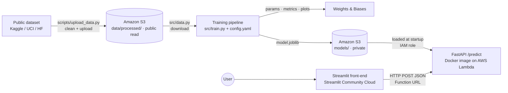

# &lt;Project Name&gt;

> 🚧 **Status: planning.** We haven't picked the dataset or the problem yet; we'll decide at kickoff. Sections marked **TODO** get filled in as we build. The stack is chosen: AWS (S3 and Lambda), Weights & Biases, FastAPI, and Streamlit. See the [Development Plan](docs/DEVELOPMENT_PLAN.md) for the reasoning and the open decisions.

**TODO:** One-sentence pitch: what we predict, for whom, and why it's useful.

| | |
|---|---|
| 🖥️ **Live app** | TODO: `https://<app-name>.streamlit.app` |
| 🔌 **Prediction API** | TODO: `https://<url-id>.lambda-url.<region>.on.aws/predict` |
| 📖 **API docs (Swagger UI)** | TODO: `https://<url-id>.lambda-url.<region>.on.aws/docs` |
| 📈 **Experiment tracking** | TODO: `https://wandb.ai/<entity>/<project>` |

*AIPI 510, Module Project 3 (Data/ML Engineering), Duke University*
**Due:** Tuesday, November 24, 2026, 11:30 AM EST
**Team:** Haydn Stucker ([haydn-s](https://github.com/haydn-s)) · Jothi Gupta ([jothigup](https://github.com/jothigup))

---

## Table of Contents

- [\<Project Name\>](#project-name)
  - [Table of Contents](#table-of-contents)
  - [Project Overview](#project-overview)
  - [Architecture](#architecture)
  - [Dataset](#dataset)
  - [Problem Definition \& Evaluation](#problem-definition--evaluation)
  - [Model](#model)
  - [Cloud Services](#cloud-services)
  - [Language Choice: Python vs. Go](#language-choice-python-vs-go)
  - [Project Structure](#project-structure)
  - [Getting Started](#getting-started)
    - [Prerequisites](#prerequisites)
    - [Install](#install)
    - [The PyDev environment](#the-pydev-environment)
    - [Authenticate](#authenticate)
    - [Environment variables](#environment-variables)
  - [Usage](#usage)
    - [1. Upload the cleaned dataset to the cloud (one-time)](#1-upload-the-cleaned-dataset-to-the-cloud-one-time)
    - [2. Train the model](#2-train-the-model)
    - [3. Run the API locally](#3-run-the-api-locally)
    - [4. Run everything with Docker](#4-run-everything-with-docker)
    - [5. Deploy the API to AWS Lambda](#5-deploy-the-api-to-aws-lambda)
    - [6. Run and deploy the front-end](#6-run-and-deploy-the-front-end)
  - [Configuration](#configuration)
  - [API Reference](#api-reference)
  - [Ethics, Limitations \& Responsible Use](#ethics-limitations--responsible-use)
  - [Contributing](#contributing)
    - [Commit messages](#commit-messages)
    - [Code style and the pre-PR check](#code-style-and-the-pre-pr-check)
    - [CI checks](#ci-checks)
    - [Branch protection](#branch-protection)
    - [Secret scanning](#secret-scanning)
    - [Dependency updates](#dependency-updates)
    - [Planned tooling](#planned-tooling)
  - [License \& Acknowledgments](#license--acknowledgments)

---

## Project Overview

**Problem.** TODO: What question does the model answer? Who would use it?

**Goals.** Build and deploy a reproducible, end-to-end ML system:

- Source a public dataset, clean it, and host it in cloud storage
- Train a model with a **config-driven, reproducible pipeline** that pulls data from the cloud
- **Track experiments** (parameters, metrics, plots, model artifacts)
- **Containerize** training and serving in a single Docker image
- Serve predictions from a **FastAPI `/predict` endpoint deployed to AWS Lambda** at a public HTTPS URL
- Ship a **public front-end** that calls the live API and presents its predictions in a clear, interactive way

**Non-goal.** State-of-the-art accuracy. This project is about engineering and MLOps practice. We keep the model simple on purpose.

## Architecture



## Dataset

| | |
|---|---|
| **Name** | TODO |
| **Source / link** | TODO |
| **License** | TODO (confirm it allows reuse and redistribution) |
| **Size** | TODO rows × TODO columns |
| **Target variable** | TODO |
| **Cloud location** | TODO: `s3://<bucket>/data/processed/<file>` (publicly readable) |

**Features used.**

| Feature | Type | Description |
|---|---|---|
| TODO | numeric / categorical | TODO |

**Cleaning & preprocessing.** TODO: missing-value handling, dropped columns and why, type fixes, outlier handling, leakage checks. Raw-to-processed cleaning happens in `scripts/upload_data.py`. Model-time transforms (scaling, encoding) live in the training pipeline so the API can reuse them.

## Problem Definition & Evaluation

| | |
|---|---|
| **Task** | TODO: classification / regression |
| **Target** | TODO |
| **Primary metric** | TODO, e.g. F1 / ROC-AUC (classification) or RMSE / MAE (regression) |
| **Why this metric** | TODO |
| **Baseline** | TODO, e.g. majority class or mean prediction |
| **Split** | Train / validation / test with ratios set in `config.yaml` and a fixed random seed |

## Model

**Model.** TODO, e.g. a scikit-learn `Pipeline` with a `ColumnTransformer` (imputation + scaling + one-hot encoding) feeding a `RandomForestClassifier`. The full preprocessing + model pipeline is serialized as one artifact, so the API applies exactly the same transforms as training.

**Hyperparameters.** All hyperparameters are set in [`config.yaml`](config.yaml) and logged to the experiment tracker on every run.

**Results.**

| Model | Val metric | Test metric | W&B run |
|---|---|---|---|
| Baseline | TODO | TODO | TODO |
| TODO | TODO | TODO | TODO |

TODO: one paragraph on what worked, what didn't, and where the model fails (see [Ethics & Limitations](#ethics-limitations--responsible-use)).

## Cloud Services

| Service | Purpose |
|---|---|
| **Amazon S3** | Hosts the cleaned dataset (publicly readable) and the trained model artifacts (private). Versioning is on |
| **Amazon ECR** | Stores the Docker image that Lambda runs |
| **AWS Lambda** | Runs the containerized FastAPI service at a public HTTPS Function URL, through the [AWS Lambda Web Adapter](https://github.com/awslabs/aws-lambda-web-adapter). Scales to zero when idle. Reads the model from S3 through its IAM role, so it stores no AWS keys |
| **Weights & Biases** | Experiment tracking: parameters, metrics, plots, versioned model artifacts |
| **Streamlit Community Cloud** | Hosts the public front-end, deployed straight from this repo |
| **GitHub Actions** | CI checks on every pull request (see [CI checks](#ci-checks)) |

## Language Choice: Python vs. Go

We looked at Go for two reasons: it's widely used in industry, and this pipeline will be reused in a Deep Learning course in Spring 2027. **Decision: Python for this project and for the course. Go is worth learning for the serving and infrastructure layer, not for model development.**

**Where Go is the industry standard.** Go dominates cloud infrastructure. Docker, Kubernetes, Terraform, and Prometheus are all written in it. It's also growing in ML *infrastructure*: Ollama's server is mostly Go, and the W&B Python SDK ships a Go core service. Model *development* (training, research, experimentation) is still overwhelmingly Python. PyTorch, TensorFlow/Keras, JAX, scikit-learn, and Hugging Face are all Python-first.

### Ecosystem (snapshot, November 2026)

| Need | Python | Go |
|---|---|---|
| Arrays and numerics | NumPy, SciPy | gonum (active) |
| DataFrames | pandas | No maintained equivalent (gota is archived) |
| Classical ML | scikit-learn, XGBoost, statsmodels | GoLearn (no commits since January 2024). Otherwise, write it yourself |
| Deep learning | PyTorch, TensorFlow/Keras, JAX | GoMLX (active: XLA backend for CPU/GPU/TPU, plus pure-Go and ONNX backends). Gorgonia (inactive since 2024) and the gotch libtorch bindings (inactive since early 2025) |
| Pretrained models | Hugging Face, torchvision, Keras | Load ONNX exports through ONNX Runtime (onnxruntime_go, active) |
| Notebooks and plots | Jupyter, matplotlib, seaborn, plotly | GoNB (a Go kernel for Jupyter), gonum/plot |
| Experiment tracking | Official W&B and MLflow SDKs | No official client libraries. Call their HTTP APIs directly |
| Serving an API | FastAPI, Flask | Standard library `net/http`. Excellent |
| Front-end | Streamlit, Gradio | None. You'd build a separate web app |

### Feasibility

- **This project.** The assignment names FastAPI or Flask for the API, Streamlit/Gradio/NextJS for the front-end, MLflow or W&B for tracking, and `requirements.txt` or `environment.yaml` for dependencies. The required parts have to be Python, so Go could only be an *extra*.
- **Training in Go.** Possible, but we'd hand-write the preprocessing that scikit-learn pipelines give us for free, and we'd lose the W&B SDK.
- **Serving in Go.** The most realistic use. Export the trained scikit-learn pipeline to ONNX with `skl2onnx`, then serve it from a Go `net/http` service using ONNX Runtime. The catch: ONNX Runtime is a C library, so the Go build needs cgo, and the Docker image needs the library.
- **The Deep Learning course.** Course materials, assignments, and pretrained models will be in PyTorch or TensorFlow. Working in Go would mean translating every example. GoMLX makes it possible, but we'd be early adopters with few examples to learn from.

### Learning curve

| | Python | Go |
|---|---|---|
| The language | We already know it | Small and quick to learn: 25 keywords, one standard formatter (`gofmt`), fast compiles, static types. Expect days to a few weeks to become productive |
| ML in that language | Huge ecosystem of tutorials, Q&A, and course material | Steep. Few examples, no notebook-first culture, and native libraries need cgo, which complicates builds |
| Day-to-day friction | Environment and package management (handled here by PyDev and `make venv`). Type errors show up only at runtime | Verbose explicit error handling. More code for exploratory work |

### Anticipated performance

Most ML computation doesn't run in Python at all. NumPy, pandas, scikit-learn, PyTorch, and TensorFlow hand the heavy work to optimized C, C++, and CUDA code, so the calling language matters less than you'd expect.

| Workload | Likely faster | Why |
|---|---|---|
| Model training, especially on GPU | Python, or a tie at best | Both end up in native kernels, and Python's GPU support (CUDA, Apple MPS) is far more mature |
| Vectorized data prep | Tie | NumPy and pandas operations already run in C |
| Hand-written loops over rows | Go, often by an order of magnitude or more | Compiled vs. interpreted. Vectorizing the Python version closes most of the gap |
| API latency at our traffic (a class demo) | Tie | Model inference dominates request time |
| API throughput and memory under heavy load | Go | Goroutines handle many concurrent requests in one lightweight process. Python servers scale by adding worker processes |
| Container size and cold start | Go | A plain Go service compiles to one binary, so images can be tens of MB (ONNX Runtime adds its library). Python plus ML libraries runs from hundreds of MB to several GB. This matters most on serverless platforms that start containers on demand |
| Speed of experimenting | Python | Notebooks, libraries, examples |

### Recommendation

Keep Python as the project language. For hands-on Go experience without risking the deadline, the best fit is an **optional stretch goal**, once everything required is done:

1. Export our model to ONNX.
2. Write a small Go service that serves the same `/predict` request and response.
3. Deploy it next to the FastAPI service.
4. Load-test both (e.g., with [`hey`](https://github.com/rakyll/hey) or [k6](https://k6.io/)) and compare latency, throughput, memory, image size, and cold start.

That turns the table above into measured numbers. It's listed as a stretch task in the [Development Plan](docs/DEVELOPMENT_PLAN.md#stretch-optional-go-inference-service).

## Project Structure

> Proposed layout. We'll update it as the code lands.

```
.
├── config.yaml              # All pipeline parameters (data paths, features, split, model, tracking)
├── requirements.txt         # Pipeline + API runtime dependencies (pinned; used by Docker and CI)
├── requirements-dev.txt     # Dev tooling: pre-commit, pytest
├── requirements-pydev.txt   # PyDev environment: data science + deep learning stack (local only)
├── pyproject.toml           # Shared code style (ruff) and pytest settings
├── Makefile                 # Dev commands: make venv, setup, format, lint, test, pr-ready
├── Dockerfile               # One image with `train` and `serve` entry points
├── entrypoint.sh            # Dispatches `train` | `serve`
├── .env.example             # Required environment variables (no secrets committed)
├── .commitlintrc.yaml       # Commit message rules (Conventional Commits)
├── .pre-commit-config.yaml  # Local git hooks: commitlint, gitleaks, ruff, file checks
├── .github/
│   ├── workflows/ci.yml     # CI checks run on every PR
│   ├── rulesets/            # Branch protection for main, kept as code
│   ├── CODEOWNERS           # Auto-requests partner review on every PR
│   ├── dependabot.yml       # Weekly dependency update PRs
│   └── pull_request_template.md
├── scripts/
│   └── upload_data.py       # One-time: download raw data → clean → upload to cloud storage
├── src/
│   ├── config.py            # Load + validate config.yaml
│   ├── data.py              # Download processed data from cloud storage
│   ├── features.py          # Preprocessing / feature engineering (sklearn ColumnTransformer)
│   ├── train.py             # Entry point: split → train → evaluate → log → save model
│   └── evaluate.py          # Metrics + plots
├── api/
│   ├── main.py              # FastAPI app: /health, /predict
│   └── schemas.py           # Pydantic request/response models
├── frontend/
│   ├── app.py               # Streamlit UI that calls the deployed API
│   └── requirements.txt     # Front-end-only dependencies (used by Streamlit Cloud)
├── tests/
│   ├── test_api.py
│   ├── test_features.py
│   └── sample_request.json  # Example payload for curl / Postman
├── notebooks/
│   └── eda.ipynb            # Exploration only; the pipeline never depends on notebooks
└── docs/
    └── DEVELOPMENT_PLAN.md
```

## Getting Started

### Prerequisites

- [uv](https://docs.astral.sh/uv/) (recommended, and it installs Python 3.12 for you) or Python 3.12
- `make` (preinstalled on macOS and Linux. On Windows, use WSL or Git Bash)
- [Node.js](https://nodejs.org/) 22.12+ (`make pr-ready` uses it to run commitlint)
- [Docker](https://docs.docker.com/get-docker/)
- The [AWS CLI v2](https://docs.aws.amazon.com/cli/latest/userguide/getting-started-install.html) and a login to our AWS account (ask the account owner). Not needed just to train: the processed data is publicly readable
- A [Weights & Biases](https://wandb.ai/) account (W&B is now part of CoreWeave Forge). Students can apply for the free academic plan with a university email. Not needed just to train: set `WANDB_MODE=disabled`

### Install

```bash
git clone git@github.com:haydn-s/sourcing-data-project-3.git
cd sourcing-data-project-3
make venv              # creates PyDev (Python 3.12) and installs requirements-pydev.txt
source PyDev/bin/activate
make setup             # installs the git hooks: commitlint, gitleaks, ruff, file checks
cp .env.example .env   # then fill in values
```

`make venv` uses uv if it's installed, and falls back to `python3.12 -m venv`. Without `make`:

```bash
uv venv --seed --python 3.12 PyDev   # or: python3.12 -m venv PyDev
source PyDev/bin/activate            # Windows: PyDev\Scripts\activate
pip install -r requirements-pydev.txt
pre-commit install
```

`pre-commit install` is required once per clone. Without it, problems aren't caught until CI fails on your PR. The first commit afterward takes a minute or two while pre-commit builds the hook tools; after that, hooks run in seconds.

### The PyDev environment

PyDev is our shared local environment for data science and deep learning work (Python 3.12). It's defined in [`requirements-pydev.txt`](requirements-pydev.txt), with every version pinned:

| Area | Libraries |
|---|---|
| Numerics and data | numpy, pandas, scipy, pyarrow |
| Statistics and classical ML | statsmodels, scikit-learn, xgboost |
| Deep learning | torch, torchvision, tensorflow (includes Keras) |
| Visualization | matplotlib, seaborn, plotly, shap |
| Notebooks | jupyterlab, ipykernel, ipywidgets |
| Tracking and utilities | wandb, pyyaml, python-dotenv, tqdm |
| Dev tooling | pre-commit, pytest (from `requirements-dev.txt`) |

To use PyDev from Jupyter or VS Code notebooks, register it as a kernel once:

```bash
python -m ipykernel install --user --name PyDev
```

**Hardware notes.** On Apple Silicon, PyTorch can use the GPU through MPS (`torch.backends.mps.is_available()`), while TensorFlow runs on the CPU unless you add Apple's optional `tensorflow-metal` plugin. torch 2.12 and newer need macOS 14 or later.

**Requirements files.** Each environment installs only what it needs:

| File | Installed by | Contents |
|---|---|---|
| `requirements.txt` | Docker image, CI | Runtime dependencies for the pipeline and API (added with the code) |
| `requirements-dev.txt` | CI, PyDev | pre-commit, pytest |
| `requirements-pydev.txt` | PyDev (local only) | The data science and deep learning stack above, plus dev tooling |
| `frontend/requirements.txt` | Streamlit Community Cloud | Front-end only (added with the front-end) |

Keeping torch and TensorFlow out of `requirements.txt` keeps the API's Docker image and CI runs small. When `requirements.txt` lands, PyDev will include it, and shared pins such as scikit-learn must match: a model saved with one scikit-learn version may not load in another.

### Authenticate

```bash
wandb login
```

Set up an AWS CLI profile so local code can read and write S3. Use the first command if the account uses IAM Identity Center, or the second if you have an IAM user's access keys:

```bash
aws configure sso --profile project3
```

```bash
aws configure --profile project3
```

Check which account and role you're signed in as:

```bash
aws sts get-caller-identity --profile project3
```

Then set `AWS_PROFILE=project3` in `.env`. With Identity Center, run `aws sso login --profile project3` when your session expires.

### Environment variables

Non-secret settings live in `config.yaml`. Secrets and deployment-specific values go in environment variables (`.env` locally, never committed).

| Variable | Used by | Description |
|---|---|---|
| `AWS_PROFILE` | pipeline | AWS CLI profile with access to our S3 bucket (see [Authenticate](#authenticate)). Lambda doesn't need it: it uses its IAM role |
| `AWS_REGION` | pipeline, API | Region of our bucket, e.g. `us-east-1`. Lambda sets it automatically |
| `WANDB_API_KEY` | pipeline | W&B API key (or run `wandb login`) |
| `WANDB_MODE` | pipeline | Optional. `offline` or `disabled` lets you train without a W&B account |
| `MODEL_URI` | API | Model location: `s3://<bucket>/models/latest/model.joblib` or a local path |
| `API_URL` | front-end | Base URL of the deployed API (the Lambda Function URL) |

## Usage

### 1. Upload the cleaned dataset to the cloud (one-time)

```bash
python scripts/upload_data.py --config config.yaml
```

### 2. Train the model

```bash
python -m src.train --config config.yaml
```

This downloads the processed data from S3, splits it, trains, evaluates on the validation and test sets, logs everything to W&B, and saves the model pipeline locally and to S3 under `models/`. To run an experiment, edit `config.yaml` (or copy it, e.g. `configs/rf_deep.yaml`) and re-run.

**Without our accounts.** Training still runs without AWS credentials (the processed data is public, and the model is saved locally only) or a W&B account:

```bash
WANDB_MODE=disabled python -m src.train --config config.yaml
```

### 3. Run the API locally

```bash
MODEL_URI=models/model.joblib uvicorn api.main:app --reload --port 8080
```

```bash
curl http://localhost:8080/health
```

```bash
curl -X POST http://localhost:8080/predict \
  -H "Content-Type: application/json" \
  -d @tests/sample_request.json
```

Interactive docs: <http://localhost:8080/docs>

### 4. Run everything with Docker

```bash
docker build -t project3 .
```

The container reads your AWS login from your mounted `~/.aws` folder, and `AWS_PROFILE` in `.env` picks the profile. If the image ends up running as a non-root user, change `/root/.aws` to that user's home.

Train inside the container:

```bash
docker run --rm --env-file .env -v "$HOME/.aws:/root/.aws" project3 train
```

Serve the API (the default command) on port 8080:

```bash
docker run --rm -p 8080:8080 --env-file .env -v "$HOME/.aws:/root/.aws" project3 serve
```

### 5. Deploy the API to AWS Lambda

> Planned steps. We'll confirm the exact commands during task B4.

Set a few shell variables first, replacing the region if needed:

```bash
export AWS_PROFILE=project3 AWS_REGION=us-east-1 FUNCTION=project3-api REPO=project3-api
export REGISTRY="$(aws sts get-caller-identity --query Account --output text).dkr.ecr.$AWS_REGION.amazonaws.com"
export IMAGE="$REGISTRY/$REPO:latest"
```

**1. Build the image.** Lambda accepts only a single-platform image without buildx's default attestations, so build it this way on every machine, Apple Silicon included:

```bash
docker buildx build --platform linux/amd64 --provenance=false --sbom=false -t "$IMAGE" --load .
```

**2. Push it to ECR.** Create the repository the first time only:

```bash
aws ecr create-repository --repository-name "$REPO"
```

Then sign Docker in to ECR and push:

```bash
aws ecr get-login-password | docker login --username AWS --password-stdin "$REGISTRY"
docker push "$IMAGE"
```

**3. Create the function (first time only).** In the Lambda console, choose **Create function → Container image**, pick the image, and set the architecture to **x86_64**. Then, under **Configuration**:

- **General configuration:** memory 2048 MB, timeout 30 seconds
- **Environment variables:** `MODEL_URI=s3://<bucket>/models/latest/model.joblib`
- **Permissions:** open the execution role and add a policy that allows `s3:GetObject` on `arn:aws:s3:::<bucket>/models/*`
- **Function URL:** create one with auth type **NONE**. The console adds both permissions a public URL needs (`lambda:InvokeFunctionUrl` and `lambda:InvokeFunction`)

**4. Deploy later changes.** Rebuild and push (steps 1 and 2), then point the function at the new image:

```bash
aws lambda update-function-code --function-name "$FUNCTION" --image-uri "$IMAGE"
```

Confirm the deployed endpoint works. The first request after the function sits idle takes a few extra seconds (a cold start):

```bash
curl -X POST https://<url-id>.lambda-url.<region>.on.aws/predict \
  -H "Content-Type: application/json" \
  -d @tests/sample_request.json
```

### 6. Run and deploy the front-end

Locally:

```bash
pip install -r frontend/requirements.txt
API_URL=http://localhost:8080 streamlit run frontend/app.py
```

Deploy on [Streamlit Community Cloud](https://share.streamlit.io/): **New app** → this repo → branch `main` → main file `frontend/app.py`. Then under **Advanced settings → Secrets**, add:

```toml
API_URL = "https://<url-id>.lambda-url.<region>.on.aws"
```

## Configuration

Every pipeline parameter lives in [`config.yaml`](config.yaml). Proposed shape:

```yaml
seed: 42
data:
  remote_uri: s3://<bucket>/data/processed/<file>.csv
  local_path: data/processed/<file>.csv
  target: <target_column>
features:
  numeric: [<col_a>, <col_b>]
  categorical: [<col_c>]
split:
  test_size: 0.15
  val_size: 0.15
  stratify: true
model:
  type: random_forest            # e.g. logistic_regression | random_forest | xgboost
  params:
    n_estimators: 200
    max_depth: 10
tracking:
  project: <wandb-project>
  entity: <wandb-entity>
output:
  local_dir: models/
  remote_prefix: s3://<bucket>/models/
```

## API Reference

| Method | Path | Description |
|---|---|---|
| `GET` | `/health` | Liveness check; returns model version |
| `POST` | `/predict` | Returns a prediction for one input record |
| `GET` | `/docs` | Auto-generated Swagger UI |

**Example request** (TODO: replace with real features):

```json
{
  "feature_a": 3.2,
  "feature_b": "category_x"
}
```

**Example response:**

```json
{
  "prediction": "TODO",
  "probability": 0.82,
  "model_version": "TODO (e.g. W&B run ID)"
}
```

## Ethics, Limitations & Responsible Use

TODO: fill this in once we choose the dataset. Questions to answer:

- **Data provenance & consent:** Who collected the data, when, and for what purpose? Does using it this way match that purpose?
- **Representativeness & bias:** Which populations, regions, or time periods are over- or under-represented? Does the data include sensitive attributes (directly or through proxies), and how does performance differ across subgroups?
- **Intended use & misuse:** What decisions should this model *not* be used for? What happens when a prediction is wrong, and who bears the cost?
- **Limitations:** Dataset age, distribution shift, small sample sizes, metric trade-offs, features we couldn't capture.
- **Privacy:** Does the dataset contain personal information? Does the API log user inputs?
- **Transparency in the UI:** The front-end shows a confidence score and a short disclaimer, so users don't over-trust the output.

## Contributing

All work goes through **feature branches and pull requests** into `main`. See the [Development Plan](docs/DEVELOPMENT_PLAN.md#8-git-workflow) for branch naming and the PR checklist.

### Commit messages

Commits follow [Conventional Commits](https://www.conventionalcommits.org/), enforced by [commitlint](https://commitlint.js.org/) with the rules in [`.commitlintrc.yaml`](.commitlintrc.yaml):

```
<type>(<optional scope>): <lowercase summary>

feat(api): add /predict endpoint
fix(data): handle missing values in age column
docs: add dataset description to README
```

Allowed types: `feat`, `fix`, `docs`, `style`, `refactor`, `perf`, `test`, `build`, `ci`, `chore`, `revert`. Suggested scopes: `data`, `pipeline`, `api`, `frontend`, `docker`, `deploy`, `deps`.

commitlint runs in two places:

- **Locally**, as a `commit-msg` git hook installed by `pre-commit install`. It rejects bad messages before the commit is created.
- **In CI**, on every commit in a PR *and* on the PR title.

### Code style and the pre-PR check

Our code style lives in [`pyproject.toml`](pyproject.toml), so the hooks, CI, and editors all apply the same rules:

- **Formatter:** `ruff format`, 100-character lines, double quotes
- **Linter:** `ruff check` with pycodestyle, pyflakes, import sorting, bugbear (likely bugs), pyupgrade, naming, simplify, comprehensions, NumPy, and ruff's own rules. sklearn-style names like `X_train` are allowed
- To change the style, edit `pyproject.toml` in a PR

**Before opening a PR, run:**

```bash
make pr-ready PR_TITLE="feat(api): add /predict endpoint"
```

It stops at the first failure. It checks that:

1. You're not on `main`, and the git hooks are installed
2. You have no uncommitted changes and your branch isn't behind `main` (warnings only)
3. Every pre-commit hook passes on all files (`make lint`)
4. The tests pass (`make test`)
5. Every commit on your branch, and the PR title if you pass one, follows Conventional Commits

Passing locally means CI should pass too. The one check CI adds is a gitleaks scan of every commit in the PR; locally, gitleaks runs on each commit through the hook. `make format` auto-fixes what it can.

| Command | What it does |
|---|---|
| `make venv` | Create or update the PyDev environment |
| `make setup` | Install dev tooling and git hooks (run inside PyDev) |
| `make format` | Auto-fix formatting and lint issues in all files |
| `make lint` | Run every pre-commit hook on all files |
| `make test` | Run the tests |
| `make lint-commits` | Lint the commit messages on your branch |
| `make lint-title PR_TITLE="..."` | Lint a PR title |
| `make pr-ready` | Everything above, before you open a PR |

### CI checks

[`.github/workflows/ci.yml`](.github/workflows/ci.yml) runs on every pull request and every push to `main`:

| Job | What it checks |
|---|---|
| **Commit messages & PR title** | commitlint on each commit in the PR and on the PR title |
| **Secret scan (gitleaks)** | Scans every commit in the PR for API keys, tokens, and private keys |
| **Lint (pre-commit hooks)** | `make lint`: file checks (large files, whitespace, YAML/JSON/TOML syntax) plus ruff lint and format |
| **Tests (pytest)** | `make test` (passes with a notice until the first tests exist) |
| **CI passed** | Gate job that succeeds only if every job above passed or was skipped. Branch protection requires this one check |

To add a check, add a job to `ci.yml` and list it under `ci-passed.needs`. Branch protection doesn't need to change. Planned additions: a Docker build check once the `Dockerfile` lands, and a deploy job on merge that pushes the image to ECR and updates the Lambda function.

CI calls the same `make` targets you run locally. See [Code style and the pre-PR check](#code-style-and-the-pre-pr-check).

### Branch protection

`main` is protected by a repository ruleset, kept as code in [`.github/rulesets/protect-main.json`](.github/rulesets/protect-main.json):

- No direct pushes, force pushes, or deletion. Every change goes through a pull request
- At least **1 approving review** from a collaborator with write access. You can't approve your own PR, so your partner reviews it
- Approvals are dismissed when new commits are pushed
- All review conversations must be resolved
- The **CI passed** check must succeed
- **Squash merge only.** Each PR becomes one commit on `main`, titled with the PR title, so `main` history follows Conventional Commits. Merged branches are deleted automatically
- No bypass, admins included

[`.github/CODEOWNERS`](.github/CODEOWNERS) lists both of us, so GitHub automatically requests a review from whoever didn't open the PR.

### Secret scanning

We check for leaked credentials (cloud keys, W&B API keys, tokens) at several points:

| Where | When | Tool |
|---|---|---|
| Your machine | `git commit` | gitleaks pre-commit hook. Blocks the commit, so the secret never enters git history |
| GitHub | `git push` | GitHub push protection. Rejects pushes containing known provider token formats |
| CI | Every PR | gitleaks scans each commit in the PR. A finding fails **CI passed** and blocks the merge |
| GitHub | Always | GitHub secret scanning. Watches the full history and raises alerts in the **Security** tab |

**If a secret leaks, revoke or rotate it at the provider first.** Deleting it from the code doesn't help, because it stays in git history and may already have been copied. For a false positive, add `# gitleaks:allow` to the end of the line.

### Dependency updates

[Dependabot](.github/dependabot.yml) opens weekly PRs that update pip packages, GitHub Actions, and pre-commit hooks, plus PRs for security fixes. They go through the same CI and review as any other PR.

### Planned tooling

These are deferred until the code exists:

- **Editor format-on-save.** Shared `.vscode/settings.json` and `extensions.json` that install the Ruff extension and format on save, once we confirm we both use VS Code or Cursor. Until then, `make format` does the same job.
- **Project-specific checks as pre-commit hooks.** Small scripts in `scripts/hooks/` that pre-commit runs on every commit. For example:
  - Every feature in `config.yaml` appears in the API's request schema (after task B1)
  - Notebooks are committed with outputs cleared (once `notebooks/` has content)

## License & Acknowledgments

Licensed under the [Apache License 2.0](LICENSE).

TODO: dataset citation and any other acknowledgments.
