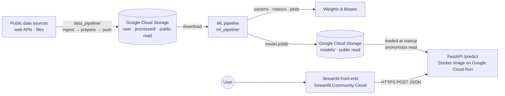

# Climate Impact Pipeline

**Is tomorrow's weather normal?** Enter today's weather at a North Carolina airport station, and a model predicts whether tomorrow's high temperature will be **expected**, an **extreme high**, or an **extreme low** for that place and time of year. It's a simple day-ahead gauge of how unusual the weather is, built to show a reproducible ML pipeline running end to end in the cloud: public data → cleaned dataset in Cloud Storage → tracked training → containerized API → live web app.

## Try It

<!-- LIVE APP: replace this block with the Streamlit link (and a screenshot) once the app is deployed. -->
> **Live app: coming soon.** The link to the Streamlit app goes here once it's deployed.

| | |
|---|---|
| 🖥️ **Live app** | TODO: `https://<app-name>.streamlit.app` |
| 🔌 **Prediction API** | TODO: `https://project3-api-<id>.us-east1.run.app/predict` (`make deploy-url` prints it) |
| 📖 **API docs (Swagger UI)** | TODO: `https://project3-api-<id>.us-east1.run.app/docs` |
| 📈 **Experiment tracking** | [wandb.ai/dhs27-duke-university/sourcing-data-project-3](https://wandb.ai/dhs27-duke-university/sourcing-data-project-3) (TODO: the first logged run creates it; then make it public) |
| 🗂️ **Processed dataset** | [`processed/nc_weather_daily.parquet`](https://storage.googleapis.com/climate-impact-pipeline-data/processed/nc_weather_daily.parquet) (public, no login) |

> 🚧 **Status (November 20, 2026).** The data pipeline is done: it fetches six public sources and publishes the cleaned, featured dataset to Cloud Storage. The ML pipeline (training, evaluation, W&B logging) is in progress. The API's Docker image is built and deploys to Google Cloud Run with `make deploy`. The Streamlit front-end is built. A full end-to-end run is planned for Sunday, November 22. Sections marked **TODO** get filled in as each piece lands.

*AIPI 510, Module Project 3 (Data/ML Engineering), Duke University*
**Due:** Tuesday, November 24, 2026, 11:30 AM EST
**Team:** Haydn Stucker ([haydn-s](https://github.com/haydn-s)) · Jothi Gupta ([jothigup](https://github.com/jothigup))

---

## Table of Contents

- [Climate Impact Pipeline](#climate-impact-pipeline)
  - [Try It](#try-it)
  - [Table of Contents](#table-of-contents)
  - [Project Overview](#project-overview)
  - [Architecture](#architecture)
  - [Dataset](#dataset)
  - [Problem Definition \& Evaluation](#problem-definition--evaluation)
  - [Model](#model)
  - [Cloud Services](#cloud-services)
  - [Language Choice: Python vs. Go](#language-choice-python-vs-go)
  - [Project Structure](#project-structure)
  - [Getting Started](#getting-started)
    - [Prerequisites](#prerequisites)
    - [Install](#install)
    - [The PyDev environment](#the-pydev-environment)
    - [Authenticate](#authenticate)
    - [Set up Cloud Storage (one-time)](#set-up-cloud-storage-one-time)
    - [Set up your .env](#set-up-your-env)
  - [Usage](#usage)
    - [1. Build the dataset and upload it to the cloud](#1-build-the-dataset-and-upload-it-to-the-cloud)
    - [2. Train the model](#2-train-the-model)
    - [3. Run the API locally](#3-run-the-api-locally)
    - [4. Run everything with Docker](#4-run-everything-with-docker)
    - [5. Deploy the API to Google Cloud Run](#5-deploy-the-api-to-google-cloud-run)
    - [6. Run and deploy the front-end](#6-run-and-deploy-the-front-end)
  - [Configuration](#configuration)
  - [API Reference](#api-reference)
  - [Ethics, Limitations \& Responsible Use](#ethics-limitations--responsible-use)
  - [Contributing](#contributing)
    - [Commit messages](#commit-messages)
    - [Code style and the pre-PR check](#code-style-and-the-pre-pr-check)
    - [CI checks](#ci-checks)
    - [Branch protection](#branch-protection)
    - [Secret scanning](#secret-scanning)
    - [Dependency updates](#dependency-updates)
    - [Planned tooling](#planned-tooling)
  - [License \& Acknowledgments](#license--acknowledgments)

---

## Project Overview

**Problem.** Given a North Carolina airport weather station, the month, and today's and yesterday's temperatures, will **tomorrow's high** be *expected*, an *extreme high*, or an *extreme low* compared with that station's 1991–2020 climate for that time of year? It's a small, honest forecasting task. The label is a fact about tomorrow that today's inputs don't contain, so the model has to predict it. It also needs only a few inputs a person can type into a form. Anyone curious whether tomorrow will feel unusual could use it. As climate shifts, it also shows how often days fall outside the range our recent past calls normal.

**Goals.** Build and deploy a reproducible, end-to-end ML system:

- Source a public dataset, clean it, and host it in cloud storage
- Train a model with a **config-driven, reproducible pipeline** that pulls data from the cloud
- **Track experiments** (parameters, metrics, plots, model artifacts)
- **Containerize** training and serving in a single Docker image
- Serve predictions from a **FastAPI `/predict` endpoint deployed to Google Cloud Run** at a public HTTPS URL
- Ship a **public front-end** that calls the live API and presents its predictions in a clear, interactive way

**Non-goal.** State-of-the-art accuracy. This project is about engineering and MLOps practice. We keep the model simple on purpose.

## Architecture



## Dataset

The data pipeline fetches six public sources through their web APIs and saves each one, unchanged, as a raw snapshot in the bucket (`raw/<name>.csv`, with a `manifest.json` that records where and when each came from). Two of them build the model's dataset. The other four are kept for later projects, but nothing uses them yet.

| Source | What we fetch | Used for |
|---|---|---|
| `weather`: [NOAA GHCN-Daily](https://www.ncei.noaa.gov/products/land-based-station/global-historical-climatology-network-daily), through the [Climate Data Online API](https://www.ncdc.noaa.gov/cdo-web/webservices/v2) | Daily high and low temperature (°F) at five North Carolina airports, 1991 through October 2026 | **The dataset's rows** |
| `stations`: NOAA CDO station metadata | Each station's name, latitude, longitude, and elevation | **Joined on** `station_id` |
| `colonies`: [USDA NASS Quick Stats](https://quickstats.nass.usda.gov/) | Honey bee colonies (inventory, losses, and their causes) and honey, by state, 2015 onward | Kept for later projects |
| `climate`: NOAA CDO Global Summary of the Year | Yearly average temperature and precipitation at North Carolina stations, 2015–2024 | Kept for later projects |
| `electricity`: [EIA Open Data](https://www.eia.gov/opendata/) | Yearly retail electricity sales, price, and customers, by state, 2001 onward | Kept for later projects |
| `ice_mass`: [NASA GRACE/GRACE-FO](https://podaac.jpl.nasa.gov/dataset/GREENLAND_MASS_TELLUS_MASCON_CRI_TIME_SERIES_RL06.3_V4) (PO.DAAC) | Greenland's monthly ice mass change since 2002 | Kept for later projects |

The stations are Raleigh-Durham (RDU), Charlotte (CLT), Greensboro (GSO), Asheville (AVL), and Wilmington (ILM): the coast, the Piedmont, and the mountains. Each has a complete daily record.

| | |
|---|---|
| **Name** | North Carolina daily weather, with tomorrow's high labeled against the 1991–2020 climate |
| **Source / link** | NOAA [GHCN-Daily](https://www.ncei.noaa.gov/products/land-based-station/global-historical-climatology-network-daily) via the [CDO API](https://www.ncdc.noaa.gov/cdo-web/webservices/v2) (stations `USW00013722`, `USW00013881`, `USW00013723`, `USW00003812`, `USW00013748`) |
| **License** | U.S. government data in the public domain, free to reuse and redistribute. NOAA asks that it be cited ([Acknowledgments](#license--acknowledgments)) |
| **Size** | 65,424 rows (one per station per day, January 2, 1991 to October 30, 2026) × 13 columns, a 470 KB Parquet file |
| **Target variable** | `tomorrow_category`: `expected`, `extreme high`, or `extreme low` |
| **Cloud location** | `gs://climate-impact-pipeline-data/processed/nc_weather_daily.parquet`, publicly readable (also over [HTTPS](https://storage.googleapis.com/climate-impact-pipeline-data/processed/nc_weather_daily.parquet)) |

**Features used.** These five are what the form asks for:

| Feature | Type | Description |
|---|---|---|
| `station` | categorical | The airport: Asheville, Charlotte Douglas, Greensboro Piedmont Triad, Raleigh Durham, or Wilmington |
| `month` | categorical | Today's month, `January` to `December`. It stands in for the season, and one-hot encoding lets a linear model learn each month's normal |
| `today_high_f` | numeric | Today's high temperature, °F |
| `today_low_f` | numeric | Today's low temperature, °F |
| `yesterday_high_f` | numeric | Yesterday's high temperature, °F |

The table also keeps `date`, `station_id`, `latitude`, `longitude`, and `elevation_m`, which can be used for a time-ordered split or later features. It keeps `tomorrow_high_f`, the temperature the label comes from, for a regression variant. Never use it as a feature for the classifier, since it *is* the answer. It also keeps `today_category`, today's own label, which gives a persistence baseline ("tomorrow will be like today"). The front-end can't supply it, so it isn't a feature.

**The label.** For each station and calendar day, the 10th and 90th percentiles of the daily high over **1991–2020** (NOAA's current climate normals period) set the normal range. Each percentile uses the days within a week either side of that date, about 450 values. Tomorrow's high above the 90th percentile is an `extreme high`, below the 10th is an `extreme low`, and anything else is `expected`. In the baseline years, that makes 8.4% of days extreme highs and 8.8% extreme lows. That's a little under 1 in 10, because a high exactly at the threshold counts as expected. In 2021–2026, extreme highs rose to 12.2% of days and extreme lows fell to 5.5%. Because the baseline period is fixed, the most recent years never shape their own labels.

**Cleaning & preprocessing.** It all happens in [`data_pipeline/prepare.py`](data_pipeline/prepare.py) ([Usage 1](#1-build-the-dataset-and-upload-it-to-the-cloud)). Model-time transforms (imputation, scaling, one-hot encoding) live in the ML pipeline's saved model, so the API applies the same ones.

1. **Quality flags.** NOAA marks readings that failed its quality checks. Those are dropped.
2. **Reshape.** NOAA sends one row per reading (station, date, `TMAX` or `TMIN`). They become one row per station per day, with `today_high_f` and `today_low_f`.
3. **Join.** Station metadata is joined on `station_id`. Long names are trimmed to the city ("RALEIGH DURHAM INTERNATIONAL AIRPORT, NC US" becomes "Raleigh Durham").
4. **Features and label.** Yesterday's and tomorrow's highs are looked up by calendar date, not by row order, so a missing day never pairs the wrong days. Then come the month and the labels.
5. **Drop incomplete rows.** Rows missing any feature or the label are dropped: the first and last day of the range, and the few days a station didn't report.

**Leakage checks.** Every feature is known by the end of today. The label comes only from tomorrow's high. The thresholds come from a fixed baseline period, not the whole table.

## Problem Definition & Evaluation

| | |
|---|---|
| **Task** | Classification, three classes |
| **Target** | `tomorrow_category`: `expected`, `extreme high`, or `extreme low` |
| **Primary metric** | Macro F1 (`evaluation.primary_metric: f1`) |
| **Why this metric** | The classes are imbalanced: 82.7% `expected`, 9.1% `extreme high`, and 8.2% `extreme low` overall. Accuracy would reward always answering `expected`. Macro F1 weighs the two rare classes as much as the common one, and those are the days worth catching |
| **Baselines** | Majority class (`model.type: dummy`), and persistence: tomorrow gets today's label (`today_category`), which is right 79.9% of the time |
| **Split** | Train / validation / test, with ratios set in `config.yaml` and a fixed random seed. Neighbouring days are correlated, so a split by date (for example, testing on 2023 onward) gives a more honest score. The table keeps `date` for that |

## Model

**Model.** Logistic regression (`model.type: linear`): a scikit-learn `Pipeline` whose `ColumnTransformer` imputes, scales, and one-hot encodes the features before the classifier. The whole pipeline is saved as one artifact, so the API applies exactly the same transforms as training. TODO: confirm once the ML pipeline merges, and compare it with a tree model in the experiments.

**Hyperparameters.** All hyperparameters are set in [`config.yaml`](config.yaml) and logged to W&B on every run. See [Configuration](#configuration).

**Results.**

| Model | Val metric | Test metric | W&B run |
|---|---|---|---|
| Baseline | TODO | TODO | TODO |
| TODO | TODO | TODO | TODO |

TODO: one paragraph on what worked, what didn't, and where the model fails (see [Ethics & Limitations](#ethics-limitations--responsible-use)).

## Cloud Services

| Service | Purpose |
|---|---|
| **Google Cloud Storage** | Bucket `climate-impact-pipeline-data` (project `climate-impact-pipeline`, `us-east1`) holds the raw snapshots, the processed dataset, and the trained models. It's publicly readable, so graders can rerun training and the API loads the model without Google credentials. Versioning is on |
| **Artifact Registry** | Repository `project3` (`us-east1`) stores the API's Docker image |
| **Google Cloud Run** | Runs the containerized FastAPI service (`project3-api`) at a public HTTPS URL. Scales to zero when idle, up to two instances. Reads the model from Cloud Storage at startup. The bucket is public, so the service runs as a service account with no roles and holds no keys |
| **Weights & Biases** | Experiment tracking: parameters, metrics, plots, versioned model artifacts |
| **Streamlit Community Cloud** | Hosts the public front-end, deployed straight from this repo |
| **GitHub Actions** | CI checks on every pull request (see [CI checks](#ci-checks)) |

**What the public bucket exposes.** Public read applies to this one bucket: anyone can list and download its files. It gives no access to the Google Cloud project, its settings, or the billing account, so no one can see payment details. Three things follow:

- **Anything in the bucket is public**, including file names, so never put `.env` files, keys, or credentials there.
- **Downloads are billed to us**, not the downloader. The files are small, but keep a budget alert on the billing account.
- **The trained models are public too**, since they share the bucket. Keeping them private would need a second, private bucket, and read access for the Cloud Run service account.

## Language Choice: Python vs. Go

We looked at Go for two reasons: it's widely used in industry, and this pipeline will be reused in a Deep Learning course in Spring 2027. **Decision: Python for this project and for the course. Go is worth learning for the serving and infrastructure layer, not for model development.**

**Where Go is the industry standard.** Go dominates cloud infrastructure. Docker, Kubernetes, Terraform, and Prometheus are all written in it. It's also growing in ML *infrastructure*: Ollama's server is mostly Go, and the W&B Python SDK ships a Go core service. Model *development* (training, research, experimentation) is still overwhelmingly Python. PyTorch, TensorFlow/Keras, JAX, scikit-learn, and Hugging Face are all Python-first.

### Ecosystem (snapshot, November 2026)

| Need | Python | Go |
|---|---|---|
| Arrays and numerics | NumPy, SciPy | gonum (active) |
| DataFrames | pandas | No maintained equivalent (gota is archived) |
| Classical ML | scikit-learn, XGBoost, statsmodels | GoLearn (no commits since January 2024). Otherwise, write it yourself |
| Deep learning | PyTorch, TensorFlow/Keras, JAX | GoMLX (active: XLA backend for CPU/GPU/TPU, plus pure-Go and ONNX backends). Gorgonia (inactive since 2024) and the gotch libtorch bindings (inactive since early 2025) |
| Pretrained models | Hugging Face, torchvision, Keras | Load ONNX exports through ONNX Runtime (onnxruntime_go, active) |
| Notebooks and plots | Jupyter, matplotlib, seaborn, plotly | GoNB (a Go kernel for Jupyter), gonum/plot |
| Experiment tracking | Official W&B and MLflow SDKs | No official client libraries. Call their HTTP APIs directly |
| Serving an API | FastAPI, Flask | Standard library `net/http`. Excellent |
| Front-end | Streamlit, Gradio | None. You'd build a separate web app |

### Feasibility

- **This project.** The assignment names FastAPI or Flask for the API, Streamlit/Gradio/NextJS for the front-end, MLflow or W&B for tracking, and `requirements.txt` or `environment.yaml` for dependencies. The required parts have to be Python, so Go could only be an *extra*.
- **Training in Go.** Possible, but we'd hand-write the preprocessing that scikit-learn pipelines give us for free, and we'd lose the W&B SDK.
- **Serving in Go.** The most realistic use. Export the trained scikit-learn pipeline to ONNX with `skl2onnx`, then serve it from a Go `net/http` service using ONNX Runtime. The catch: ONNX Runtime is a C library, so the Go build needs cgo, and the Docker image needs the library.
- **The Deep Learning course.** Course materials, assignments, and pretrained models will be in PyTorch or TensorFlow. Working in Go would mean translating every example. GoMLX makes it possible, but we'd be early adopters with few examples to learn from.

### Learning curve

| | Python | Go |
|---|---|---|
| The language | We already know it | Small and quick to learn: 25 keywords, one standard formatter (`gofmt`), fast compiles, static types. Expect days to a few weeks to become productive |
| ML in that language | Huge ecosystem of tutorials, Q&A, and course material | Steep. Few examples, no notebook-first culture, and native libraries need cgo, which complicates builds |
| Day-to-day friction | Environment and package management (handled here by PyDev and `make venv`). Type errors show up only at runtime | Verbose explicit error handling. More code for exploratory work |

### Anticipated performance

Most ML computation doesn't run in Python at all. NumPy, pandas, scikit-learn, PyTorch, and TensorFlow hand the heavy work to optimized C, C++, and CUDA code, so the calling language matters less than you'd expect.

| Workload | Likely faster | Why |
|---|---|---|
| Model training, especially on GPU | Python, or a tie at best | Both end up in native kernels, and Python's GPU support (CUDA, Apple MPS) is far more mature |
| Vectorized data prep | Tie | NumPy and pandas operations already run in C |
| Hand-written loops over rows | Go, often by an order of magnitude or more | Compiled vs. interpreted. Vectorizing the Python version closes most of the gap |
| API latency at our traffic (a class demo) | Tie | Model inference dominates request time |
| API throughput and memory under heavy load | Go | Goroutines handle many concurrent requests in one lightweight process. Python servers scale by adding worker processes |
| Container size and cold start | Go | A plain Go service compiles to one binary, so images can be tens of MB (ONNX Runtime adds its library). Python plus ML libraries runs from hundreds of MB to several GB. This matters most on serverless platforms that start containers on demand |
| Speed of experimenting | Python | Notebooks, libraries, examples |

### Recommendation

Keep Python as the project language. For hands-on Go experience without risking the deadline, the best fit is an **optional stretch goal**, once everything required is done:

1. Export our model to ONNX.
2. Write a small Go service that serves the same `/predict` request and response.
3. Deploy it next to the FastAPI service.
4. Load-test both (e.g., with [`hey`](https://github.com/rakyll/hey) or [k6](https://k6.io/)) and compare latency, throughput, memory, image size, and cold start.

That turns the table above into measured numbers. It's listed as a stretch task in the [Development Plan](docs/DEVELOPMENT_PLAN.md#stretch-optional-go-inference-service).

## Project Structure

```
.
├── config.yaml              # All parameters, in three parts: shared, data pipeline, ML pipeline
├── requirements.txt         # Pipeline + API runtime dependencies (pinned; used by Docker, CI, PyDev)
├── requirements-dev.txt     # Dev tooling: pre-commit, pytest, httpx2
├── requirements-pydev.txt   # PyDev environment: adds notebooks and deep learning (local only)
├── pyproject.toml           # Shared code style (ruff) and pytest settings
├── Makefile                 # Dev commands, grouped by pipeline (run `make help`)
├── configs/
│   └── demo.yaml            # Variant: runs both pipelines on a synthetic table, apart from the real data
├── Dockerfile               # One image that serves the API and runs the pipeline commands. Runs on Cloud Run
├── entrypoint.sh            # Dispatches `serve` | any other command
├── .dockerignore            # Keeps data, models, secrets, and PyDev out of the image
├── .env.example             # Environment variables to copy into .env (no secrets committed)
├── .commitlintrc.yaml       # Commit message rules (Conventional Commits)
├── .pre-commit-config.yaml  # Local git hooks: commitlint, gitleaks, ruff, file checks
├── .github/
│   ├── workflows/ci.yml     # CI checks run on every PR
│   ├── rulesets/            # Branch protection for main, kept as code
│   ├── CODEOWNERS           # Auto-requests partner review on every PR
│   ├── dependabot.yml       # Weekly dependency update PRs
│   └── pull_request_template.md
├── shared/                  # Used by both pipelines and the API
│   ├── config.py            # Load + validate config files (extends:, --set overrides)
│   ├── storage.py           # Copy files to and from Cloud Storage (anonymous reads of public files)
│   ├── tables.py            # Read/write CSV and Parquet; check a table has the config's columns
│   └── cli.py               # --config/--set options, .env loading, and logging for every command
├── data_pipeline/           # Data pipeline: sources → processed table in Cloud Storage
│   ├── ingest.py            # 1/3: fetch each source (file, http, custom types) → raw snapshots
│   ├── prepare.py           # 2/3: cleaners, joins, and feature steps → processed table
│   └── push.py              # 3/3: upload the processed table (the hand-off to the ML pipeline)
├── ml_pipeline/             # ML pipeline: processed table → trained model (in progress)
│   └── README.md            # What it reads, and the model files the API needs from it
├── api/
│   ├── main.py              # FastAPI app: /health, /metadata, /predict
│   └── schemas.py           # Response models. The request model is built from the model's metadata
├── frontend/
│   ├── app.py               # Streamlit UI. Builds its form from the API's /metadata
│   ├── api_client.py        # Calls the API and turns errors into plain messages (requests only)
│   └── requirements.txt     # Front-end-only dependencies (used by Streamlit Cloud)
├── scripts/
│   └── docker_smoke_test.sh # Checks the image's packages and commands load (make docker-smoke)
├── tests/                   # Mirrors the packages: shared/, data_pipeline/, api/, frontend/
│   ├── test_layout.py       # Each package imports only what it may (the pipelines never import each other)
│   └── sample_request.json  # Example payload for curl / Postman
├── notebooks/               # Planned (task A1)
│   └── eda.ipynb            # Exploration only; the pipeline never depends on notebooks
└── docs/
    └── DEVELOPMENT_PLAN.md
```

**Two pipelines, one hand-off.** `data_pipeline/` and `ml_pipeline/` are separate packages that never import each other (`tests/test_layout.py` enforces it). The data pipeline's only output is the processed table at `data.remote_uri`, and that table is the ML pipeline's only input. Both use `shared/` and read the same `config.yaml`, whose shared section (`data` and `features`) is the contract between them: `make push` refuses a table that doesn't match it.

## Getting Started

### Prerequisites

- [uv](https://docs.astral.sh/uv/) (recommended, and it installs Python 3.12 for you) or Python 3.12
- `make` (preinstalled on macOS and Linux. On Windows, use WSL or Git Bash)
- [Node.js](https://nodejs.org/) 22.12+ (`make pr-ready` uses it to run commitlint)
- [Docker](https://docs.docker.com/get-docker/)
- The [Google Cloud CLI](https://cloud.google.com/sdk/docs/install) and access to project `climate-impact-pipeline`, to upload data and models and to deploy the API. Not needed just to train: the processed data is publicly readable. Install it with Homebrew (`brew install --cask google-cloud-sdk`) or Google's installer (`curl https://sdk.cloud.google.com | bash`). If `gcloud` then isn't found, open a new terminal or run `source ~/.zshrc`, since the installer only updates new shells
- A [Weights & Biases](https://wandb.ai/) account (W&B is now part of CoreWeave Forge). Students can apply for the free academic plan with a university email. Not needed just to train: set `WANDB_MODE=disabled`

### Install

```bash
git clone git@github.com:haydn-s/sourcing-data-project-3.git
cd sourcing-data-project-3
make venv              # creates PyDev (Python 3.12) and installs requirements-pydev.txt
source PyDev/bin/activate
make setup             # installs the git hooks: commitlint, gitleaks, ruff, file checks
cp .env.example .env   # then fill in what you need (Set up your .env)
```

`make venv` uses uv if it's installed, and falls back to `python3.12 -m venv`. Without `make`:

```bash
uv venv --seed --python 3.12 PyDev   # or: python3.12 -m venv PyDev
source PyDev/bin/activate            # Windows: PyDev\Scripts\activate
pip install -r requirements-pydev.txt
pre-commit install
```

`pre-commit install` is required once per clone. Without it, problems aren't caught until CI fails on your PR. The first commit afterward takes a minute or two while pre-commit builds the hook tools; after that, hooks run in seconds.

### The PyDev environment

PyDev is our shared local environment for data science and deep learning work (Python 3.12). It's defined in [`requirements-pydev.txt`](requirements-pydev.txt), which includes [`requirements.txt`](requirements.txt) (the pipeline and API, plus google-cloud-storage, FastAPI, and Uvicorn), with every version pinned:

| Area | Libraries |
|---|---|
| Numerics and data | numpy, pandas, scipy, pyarrow |
| Statistics and classical ML | statsmodels, scikit-learn, xgboost |
| Deep learning | torch, torchvision, tensorflow (includes Keras) |
| Visualization | matplotlib, seaborn, plotly, shap |
| Notebooks | jupyterlab, ipykernel, ipywidgets |
| Tracking and utilities | wandb, pyyaml, python-dotenv, tqdm |
| Pipeline and serving | google-cloud-storage, requests, FastAPI, Uvicorn, pydantic (from `requirements.txt`) |
| Dev tooling | pre-commit, pytest, httpx2 (from `requirements-dev.txt`) |

To use PyDev from Jupyter or VS Code notebooks, register it as a kernel once:

```bash
python -m ipykernel install --user --name PyDev
```

**Hardware notes.** On Apple Silicon, PyTorch can use the GPU through MPS (`torch.backends.mps.is_available()`), while TensorFlow runs on the CPU unless you add Apple's optional `tensorflow-metal` plugin. torch 2.12 and newer need macOS 14 or later.

**Requirements files.** Each environment installs only what it needs:

| File | Installed by | Contents |
|---|---|---|
| `requirements.txt` | Docker image, CI, PyDev | Runtime dependencies for the pipeline and API |
| `requirements-dev.txt` | CI, PyDev | pre-commit, pytest, httpx2 |
| `requirements-pydev.txt` | PyDev (local only) | Both files above, plus notebooks, extra plotting, and deep learning |
| `frontend/requirements.txt` | Streamlit Community Cloud, PyDev | Streamlit and requests, for the front-end |

Keeping torch and TensorFlow out of `requirements.txt` keeps the API's Docker image and CI runs small. Shared packages are pinned only in `requirements.txt`, so PyDev and the image always match. That matters most for scikit-learn: a model saved with one version may not load in another, and the API logs a warning when they differ.

### Authenticate

```bash
wandb login
```

Use your own API key, from [wandb.ai/authorize](https://wandb.ai/authorize). Never share one. Runs log to the W&B team `dhs27-duke-university` (`tracking.entity` in `config.yaml`), so everyone who logs runs has to be a team member:

1. Create a W&B account, ideally with your university email (the academic plan is free).
2. The team admin invites you from the team's settings (role **Member**), and you accept the email invite.
3. Run `wandb login`.

The first logged run creates the project, `sourcing-data-project-3`. The admin then makes it public in the project's privacy settings, so graders can see the runs.

Sign in to Google Cloud so the pipeline can upload data and models to Cloud Storage. The second command saves Application Default Credentials, which the Python client uses:

```bash
gcloud config set project climate-impact-pipeline
```

```bash
gcloud auth application-default login
```

Reading the public bucket needs no login, so anyone can train without these.

To deploy the API, `gcloud` itself must be signed in too (`gcloud auth login`), with permission to deploy to Cloud Run in the project. [Usage 5](#5-deploy-the-api-to-google-cloud-run) covers the rest.

### Set up Cloud Storage (one-time)

Already done for our project. These are the steps, for the record or for a fresh project. Project IDs and bucket names are unique across all of Google Cloud.

1. Create the project and make it your default:

    ```bash
    gcloud projects create climate-impact-pipeline --name="Climate Impact Pipeline"
    ```

    ```bash
    gcloud config set project climate-impact-pipeline
    ```

2. Link a billing account in the [Cloud Console](https://console.cloud.google.com/billing). This is required even for the free tier. Add a budget alert under **Billing → Budgets & alerts** while you're there.
3. Create the bucket in a free-tier region (`us-east1`, `us-central1`, or `us-west1`), turn on versioning, and allow public access:

    ```bash
    gcloud storage buckets create gs://climate-impact-pipeline-data --location=us-east1 --uniform-bucket-level-access
    ```

    ```bash
    gcloud storage buckets update gs://climate-impact-pipeline-data --versioning --no-public-access-prevention
    ```

4. Make the bucket publicly readable:

    ```bash
    gcloud storage buckets add-iam-policy-binding gs://climate-impact-pipeline-data --member=allUsers --role=roles/storage.objectViewer
    ```

5. Check that files are publicly readable. Upload a test file, fetch it with no login (a `200` means it's public), then delete it:

    ```bash
    echo ok > check.txt && gcloud storage cp check.txt gs://climate-impact-pipeline-data/check.txt
    ```

    ```bash
    curl -I https://storage.googleapis.com/climate-impact-pipeline-data/check.txt
    ```

    ```bash
    gcloud storage rm --all-versions gs://climate-impact-pipeline-data/check.txt && rm check.txt
    ```

Uploads set `Cache-Control: no-cache` on each file, since Google otherwise caches public files for up to an hour and readers would see an old copy.

### Set up your `.env`

Settings that aren't secret live in `config.yaml`. Secrets and per-machine values go in `.env`, which git ignores. Start from the template:

```bash
cp .env.example .env
```

What you fill in depends on what you run. Nobody needs every value.

**Data pipeline** (`make ingest`, `make prepare`, `make push`):

1. Keep `GOOGLE_CLOUD_PROJECT=climate-impact-pipeline`.
2. Sign in to Google Cloud ([Authenticate](#authenticate)) so `make ingest` and `make push` can upload.
3. Uncomment and fill in a key for each source in `ingest.sources` that needs one ([below](#data-source-keys)). `make ingest` lists any that are missing, or left blank, before it fetches anything.

**ML pipeline and API** (training, and `make serve`):

1. Get added to our W&B team, `dhs27-duke-university` (`tracking.entity` in `config.yaml`), then run `wandb login` or set `WANDB_API_KEY`. Until you're on the team, or to train without a W&B account, set `WANDB_MODE=disabled`.
2. Leave `MODEL_URI` as is to serve your latest local model, or set it to `gs://climate-impact-pipeline-data/models/latest/model.joblib` to serve the published one.
3. That's all to train: training downloads the processed data from the public bucket, so it needs no data-source keys and no Google login.
4. To upload models (once `output.remote_prefix` is set in `config.yaml`), sign in to Google Cloud ([Authenticate](#authenticate)). The bucket's owner first grants your Google account write access, once:

    ```bash
    gcloud storage buckets add-iam-policy-binding gs://climate-impact-pipeline-data --member=user:name@example.com --role=roles/storage.objectAdmin
    ```

    Replace `name@example.com` with your Google account's email.

**Front-end:** set `API_URL` to the API you're calling.

#### Data source keys

Each is free, and everyone requests their own. In `config.yaml`, a source refers to its key as `${NAME}`:

| Variable | Source | Get one at | In the source's config |
|---|---|---|---|
| `NASS_API_KEY` | USDA NASS Quick Stats: bee colonies, crops | [quickstats.nass.usda.gov/api](https://quickstats.nass.usda.gov/api) | `params: {key: "${NASS_API_KEY}"}` |
| `NOAA_CDO_TOKEN` | NOAA Climate Data Online: weather station records | [ncdc.noaa.gov/cdo-web/token](https://www.ncdc.noaa.gov/cdo-web/token) | `headers: {token: "${NOAA_CDO_TOKEN}"}` |
| `EIA_API_KEY` | EIA Open Data: power plants, electricity | [eia.gov/opendata/register.php](https://www.eia.gov/opendata/register.php) | `params: {api_key: "${EIA_API_KEY}"}` |
| `EARTHDATA_TOKEN` | NASA Earthdata: GRACE ice mass (PO.DAAC) | **Generate Token** on your profile at [urs.earthdata.nasa.gov](https://urs.earthdata.nasa.gov) | `headers: {Authorization: "Bearer ${EARTHDATA_TOKEN}"}`. Tokens expire, and some NASA hosts don't take them, so check the dataset's access page |

Details for each:

- **NASS:** agree to the terms of service and enter your email; the key arrives by email. Each query returns at most 50,000 rows, so narrow big pulls by year or state.
- **NOAA CDO:** enter your email to get a 32-character token. It goes in a `token` header, not a query parameter. Each request returns at most 1,000 results and, for daily data, one year. The `noaa_cdo` source type pages through results and splits long date ranges by year (`options.chunk_years`). It also stays under CDO's limit of 5 requests a second. NOAA is reworking its data-access site, so if the token page moves, start from [ncei.noaa.gov/cdo-web](https://www.ncei.noaa.gov/cdo-web).
- **EIA:** fill in the short form; the key arrives by email. If it doesn't, check spam.
- **Earthdata:** register, then use **Generate Token** on your profile and copy it right away, since it's hidden once you leave the page. You can have two tokens at a time. Under **Applications → Authorized Apps**, approve the data centers you use (PO.DAAC for the ice data). Tokens expire, so make a new one when downloads fail with `401`.

To check which keys your `.env` sets, without printing them:

```bash
python -c "from dotenv import dotenv_values; v = dotenv_values('.env'); print({k: bool(v.get(k)) for k in ['NASS_API_KEY', 'NOAA_CDO_TOKEN', 'EIA_API_KEY', 'EARTHDATA_TOKEN']})"
```

These sources need no key: Open-Meteo (sunshine and weather), NASA POWER (solar irradiance), NOAA Climate at a Glance (state climate), the USGS earthquake catalog, the NSIDC Sea Ice Index, BTS flight data, and the GEM active faults database.

If a key ever lands in a response, ingest replaces it with `***` before saving the snapshot, since snapshots are uploaded to the public bucket. Error messages hide keys too.

#### All variables

| Variable | Used by | Description |
|---|---|---|
| `GOOGLE_CLOUD_PROJECT` | data pipeline | Our Google Cloud project, `climate-impact-pipeline` |
| `NASS_API_KEY`, `NOAA_CDO_TOKEN`, `EIA_API_KEY`, `EARTHDATA_TOKEN` | data pipeline | Data source keys ([above](#data-source-keys)) |
| `WANDB_API_KEY` | ML pipeline | W&B API key (or run `wandb login`) |
| `WANDB_MODE` | ML pipeline | Optional. `offline` or `disabled` lets you train without a W&B account |
| `MODEL_URI` | API | Model location: `gs://climate-impact-pipeline-data/models/latest/model.joblib` or a local path (default: `models/latest/model.joblib`) |
| `MODEL_CACHE_DIR` | API | Optional. Where a Cloud Storage model is downloaded (default: a folder in the system temp directory) |
| `API_URL` | front-end | Base URL of the API: `http://localhost:8080` locally, or the Cloud Run URL (`make deploy-url`) |

## Usage

Run these from the repo root, inside PyDev (`source PyDev/bin/activate`).

### 1. Build the dataset and upload it to the cloud

The data pipeline has three stages, each its own script. Run them all with `make data`, or one at a time:

```bash
make ingest
```

```bash
make prepare
```

```bash
make push
```

1. **Ingest** ([`data_pipeline/ingest.py`](data_pipeline/ingest.py)) fetches every source in `ingest.sources` and saves its rows unchanged to `data/raw/<name>.csv`, with a `manifest.json` recording when and where each came from. Sources are files (local, URL, or `gs://`) or web APIs (`type: http`, JSON or CSV). APIs that need paging get a custom type registered in the same file. With `ingest.remote_prefix` set, the snapshots are uploaded too. Add `--source NAME` to refetch just one.
2. **Prepare** ([`data_pipeline/prepare.py`](data_pipeline/prepare.py)) cleans each snapshot, joins the sources on their `join_on` columns, runs the feature steps in `prepare.feature_steps`, and writes `data.local_path`. Every source gets a standard clean (snake_case columns, trimmed text, no empty or duplicate rows). Its own cleaner, and the feature steps, are functions registered in the same file. The joins check for the usual mistakes: missing keys, mismatched key types, and keys that would duplicate rows.
3. **Push** ([`data_pipeline/push.py`](data_pipeline/push.py)) uploads the processed table to `data.remote_uri`. It refuses a table that lacks the config's features or target, since training on it would fail.

A full run takes about three minutes, most of it NOAA's daily data (about 150 requests). It needs every key in `ingest.sources` ([Data source keys](#data-source-keys)). To rebuild the processed table from the snapshots already in the bucket, with no keys or API calls, run `make prepare` and then `make push`.

**What it builds.** The rows come from the `weather` source, the first in `ingest.sources`. `stations` is joined on `station_id`, and the feature steps `daily_lags` and `tomorrow_label` add the features and the label. The result is published to [`processed/nc_weather_daily.parquet`](https://storage.googleapis.com/climate-impact-pipeline-data/processed/nc_weather_daily.parquet). [Dataset](#dataset) describes each column.

**The demo variant.** [`configs/demo.yaml`](configs/demo.yaml) runs the same three stages on a small synthetic customer table and writes only under `demo/` in the bucket. Use it to test the pipelines without the real data:

```bash
make data CONFIG=configs/demo.yaml
```

**Why keep raw snapshots.** Public data sources move. In 2026 NOAA's NCEI is retiring some download services, and NSIDC's Sea Ice Index has dropped to basic support. With every source's raw rows saved in the bucket, `make prepare` can rebuild the processed table without calling the APIs again. It downloads any snapshot that's missing locally.

**Which features belong where.** The API gets one row of inputs from the front-end, so a feature computed in `prepare` has to be something the front-end can supply or look up too. Transforms of a row's own inputs (ratios, logs, date parts) belong in the ML pipeline's saved model, so the API applies them for you. And measure anomalies against a fixed baseline period, not the whole table, so the test years don't leak into training.

**Leading zeros.** Snapshots are CSV, so codes like state FIPS `01` or ZIP codes come back as numbers. Restore them in the source's cleaner, e.g. `frame["fips"].astype(str).str.zfill(2)`.

The ML pipeline then downloads `data.remote_uri`. Because the bucket is publicly readable, that needs no Google login. The file is also at `https://storage.googleapis.com/climate-impact-pipeline-data/processed/<file>`.

### 2. Train the model

Comes with the ML pipeline, which isn't built yet. [`ml_pipeline/README.md`](ml_pipeline/README.md) describes what it reads (the processed table and `config.yaml`), the two files the API needs from it (`model.joblib` and `metadata.json`), and where to publish them (`gs://climate-impact-pipeline-data/models/`). `output.remote_prefix` in `config.yaml` stays `null` until it trains the real dataset, since `models/latest/` is what the deployed API serves.

### 3. Run the API locally

```bash
make serve
```

That runs `uvicorn api.main:create_app --factory --reload --port 8080`, serving `models/latest/model.joblib`, which the ML pipeline produces. Set `MODEL_URI` to serve another model, including one in Cloud Storage. The app is created by a factory because its request schema comes from the model it loads.

```bash
curl http://localhost:8080/health
```

```bash
curl -X POST http://localhost:8080/predict \
  -H "Content-Type: application/json" \
  -d @tests/sample_request.json
```

Interactive docs: <http://localhost:8080/docs>

### 4. Run everything with Docker

Build the image. `make docker-build` builds for `linux/amd64` without attestations, which is what Cloud Run runs, so the same image runs locally and in the cloud:

```bash
make docker-build
```

Serve the API (the default command) on port 8080, with a trained model in `models/`. A `train` command comes with the ML pipeline:

```bash
docker run --rm -p 8080:8080 --env-file .env -v "$PWD/models:/app/models" project3
```

**Smoke test.** This builds the image and checks, as a non-root user, that its packages import and the data pipeline commands start. Run it locally before changing the Dockerfile. It's out of CI until the ML pipeline produces a model: then the train-and-serve check (train inside the container, serve with a read-only filesystem, and call `/health` and `/predict`) and the CI job come back together:

```bash
make docker-smoke
```

### 5. Deploy the API to Google Cloud Run

The API runs on [Cloud Run](https://cloud.google.com/run) in project `climate-impact-pipeline`, next to the bucket. It needs Docker running and `gcloud` signed in ([Authenticate](#authenticate)).

**1. Set up the project (once).** This enables Cloud Run and Artifact Registry, creates the `project3` image repository in `us-east1` and a `project3-api` service account with no roles, and signs Docker in to the registry:

```bash
make deploy-setup
```

**2. Deploy.** This builds the `linux/amd64` image, pushes it to Artifact Registry tagged with the current commit, and deploys it as the public service `project3-api`. The service serves `gs://climate-impact-pipeline-data/models/latest/model.joblib`, so publish a model there first ([Usage 2](#2-train-the-model)). Run it again after any change to redeploy:

```bash
make deploy
```

Settings are Makefile variables, for example `make deploy SERVICE=project3-api-test DEPLOY_MODEL_URI=gs://...`. The service uses 1 CPU and 1 GiB, scales to zero when idle (the first request after that takes several seconds), and caps at two instances to keep costs down.

**3. Check it.** Print the URL, then call the API with a test record:

```bash
make deploy-url
```

```bash
curl -X POST "$(make -s deploy-url)/predict" \
  -H "Content-Type: application/json" \
  -d @tests/sample_request.json
```

**Cost.** Cloud Run's free tier covers 2 million requests a month. The image is about 1.2 GB, so Artifact Registry storage past its free 0.5 GB costs a few cents a month. Delete old images, or the service (`gcloud run services delete project3-api --region us-east1`), after grading.

### 6. Run and deploy the front-end

The app ([`frontend/app.py`](frontend/app.py)) builds its form from the API's `GET /metadata`, so it always matches the model being served: a dropdown for each categorical feature and a number box for each numeric one. **Predict tomorrow** posts the inputs to `/predict` and shows the predicted class with the model's confidence. If the API is down, slow to wake, or rejects the inputs, the app says so in plain words.

Locally, with the API running (`make serve`). PyDev already includes Streamlit:

```bash
API_URL=http://localhost:8080 streamlit run frontend/app.py
```

Deploy on [Streamlit Community Cloud](https://share.streamlit.io/): **Create app** → repository `haydn-s/sourcing-data-project-3` → branch `main` (or `frontend` until it merges) → main file `frontend/app.py`. Under **Advanced settings**, choose Python 3.12 and add the secret:

```toml
API_URL = "https://project3-api-<id>.us-east1.run.app"
```

Streamlit Cloud installs `frontend/requirements.txt`, the file beside the app, so the app deploys without the pipeline's packages. Then put the app's link in [Try it](#try-it).

## Configuration

Every pipeline parameter lives in [`config.yaml`](config.yaml), which documents each setting inline. The code holds nothing dataset-specific. Configs are validated when they load, so a typo or an impossible setting (a metric that doesn't fit the task, split sizes that leave no training rows) fails with a clear message before anything runs. The ML sections (`seed`, `task`, `split`, `model`, `evaluation`, `tracking`, `output`) are a template the ML pipeline keeps, changes, or replaces.

| Section | What it controls |
|---|---|
| `seed` | Random seed for the split and the model |
| `task` | `classification` or `regression` |
| `data` | Where the processed data lives (`remote_uri` in Cloud Storage, cached at `local_path`) and the `target` column |
| `ingest` | The data `sources` (type, location, parameters, join keys), the raw snapshot folder, and where to upload snapshots |
| `prepare` | The feature steps to run after cleaning and joining |
| `features` | The `numeric` and `categorical` columns to use. Other columns are ignored |
| `split` | Test and validation fractions (of the whole dataset), and stratification for classification |
| `model` | `type` (`dummy`, `linear`, `random_forest`, `hist_gradient_boosting`, or `xgboost`) and `params` |
| `evaluation` | `primary_metric`: `accuracy`, `f1` (macro), or `roc_auc` for classification; `rmse`, `mae`, or `r2` for regression |
| `tracking` | W&B `project`, `entity` (team), and `tags` |
| `output` | Local model folder and the Cloud Storage prefix to upload models to |

**Variants.** A config file can start with `extends: config.yaml` (a path relative to it) and list only what changes. Sections merge key by key, except `model.params`, which is replaced as a whole so each variant lists exactly the hyperparameters it uses. `--set key.path=value` overrides a single value from the command line. Values are read as YAML, so `5`, `true`, and `[a, b]` work.

**Changing the dataset.** `config.yaml` describes the weather dataset ([Dataset](#dataset)). To change it:

1. Edit `ingest.sources`, write any cleaners and feature steps in [`data_pipeline/prepare.py`](data_pipeline/prepare.py), and run `make data` ([Usage 1](#1-build-the-dataset-and-upload-it-to-the-cloud)).
2. In `config.yaml`, set `task`, the `data` section, `features`, and `evaluation.primary_metric`. Update `tracking.tags`.
3. Update [`tests/sample_request.json`](tests/sample_request.json) to one record with the new features. The `curl` examples here send it.

## API Reference

| Method | Path | Description |
|---|---|---|
| `GET` | `/health` | Liveness check; returns the model version |
| `GET` | `/metadata` | The model's features (numeric ranges, allowed categories), class labels, test metrics, and an example request. The front-end can build its form from this |
| `POST` | `/predict` | Returns a prediction for one input record |
| `GET` | `/docs` | Auto-generated Swagger UI (`/` redirects here) |

The `/predict` request schema is generated from the served model's `metadata.json`, so it always matches the model: one field per feature, categorical fields limited to the categories seen in training, and unknown fields rejected. Invalid requests get a `422` that says which field is wrong.

**Example request** ([`tests/sample_request.json`](tests/sample_request.json)):

```json
{
  "station": "Raleigh Durham",
  "month": "July",
  "today_high_f": 97.0,
  "today_low_f": 75.0,
  "yesterday_high_f": 95.0
}
```

**Example response.** `probability` is the predicted class's probability (`null` for regression), and `model_version` is the W&B run ID. The values below show the shape, not a real result:

```json
{
  "prediction": "extreme high",
  "probability": 0.58,
  "model_version": "<run-id>"
}
```

## Ethics, Limitations & Responsible Use

*Draft from the data side. TODO: review together, and add what the model results show.*

- **Provenance.** NOAA collects these readings at airport weather stations to support aviation and to keep the climate record. Using them to describe how unusual a day is fits that purpose. The data is in the public domain.
- **Representativeness.** Five airports can't stand for all of North Carolina. Airports sit in open, often paved areas that can run warmer than the countryside around them, and the model knows nothing about other places or about the hours between the daily high and low.
- **A moving baseline.** "Normal" here means 1991–2020. As the climate warms, more recent days land in `extreme high` (12.2% of days in 2021–2026, against 8.4% in 1991–2020), and the classes shift in the test years, so recent performance can differ from historical performance. That's a real limitation, and it's also the climate signal the index is meant to show.
- **Intended use.** A rough, curiosity-level gauge. It isn't a forecast, and no one should base safety decisions on it. Heat and cold warnings come from the [National Weather Service](https://www.weather.gov), and the app says so.
- **Privacy.** The inputs are weather readings, not personal data, and the API doesn't store them.

Questions to answer:

- **Data provenance & consent:** Who collected the data, when, and for what purpose? Does using it this way match that purpose?
- **Representativeness & bias:** Which populations, regions, or time periods are over- or under-represented? Does the data include sensitive attributes (directly or through proxies), and how does performance differ across subgroups?
- **Intended use & misuse:** What decisions should this model *not* be used for? What happens when a prediction is wrong, and who bears the cost?
- **Limitations:** Dataset age, distribution shift, small sample sizes, metric trade-offs, features we couldn't capture.
- **Privacy:** Does the dataset contain personal information? Does the API log user inputs?
- **Redistribution:** Our public bucket republishes each source's raw rows. Confirm each license allows that, and credit every source (see [License & Acknowledgments](#license--acknowledgments)).
- **Transparency in the UI:** The front-end shows a confidence score and a short disclaimer, so users don't over-trust the output.

## Contributing

All work goes through **feature branches and pull requests** into `main`. See the [Development Plan](docs/DEVELOPMENT_PLAN.md#8-git-workflow) for branch naming and the PR checklist.

### Commit messages

Commits follow [Conventional Commits](https://www.conventionalcommits.org/), enforced by [commitlint](https://commitlint.js.org/) with the rules in [`.commitlintrc.yaml`](.commitlintrc.yaml):

```
<type>(<optional scope>): <lowercase summary>

feat(api): add /predict endpoint
fix(data): handle missing values in age column
docs: add dataset description to README
```

Allowed types: `feat`, `fix`, `docs`, `style`, `refactor`, `perf`, `test`, `build`, `ci`, `chore`, `revert`. Suggested scopes: `data`, `pipeline`, `api`, `frontend`, `docker`, `deploy`, `deps`.

commitlint runs in two places:

- **Locally**, as a `commit-msg` git hook installed by `pre-commit install`. It rejects bad messages before the commit is created.
- **In CI**, on every commit in a PR *and* on the PR title.

### Code style and the pre-PR check

Our code style lives in [`pyproject.toml`](pyproject.toml), so the hooks, CI, and editors all apply the same rules:

- **Formatter:** `ruff format`, 100-character lines, double quotes
- **Linter:** `ruff check` with pycodestyle, pyflakes, import sorting, bugbear (likely bugs), pyupgrade, naming, simplify, comprehensions, NumPy, and ruff's own rules. sklearn-style names like `X_train` are allowed
- To change the style, edit `pyproject.toml` in a PR

**Before opening a PR, run:**

```bash
make pr-ready PR_TITLE="feat(api): add /predict endpoint"
```

It stops at the first failure. It checks that:

1. You're not on `main`, and the git hooks are installed
2. You have no uncommitted changes and your branch isn't behind `main` (warnings only)
3. Every pre-commit hook passes on all files (`make lint`)
4. The tests pass (`make test`)
5. Every commit on your branch, and the PR title if you pass one, follows Conventional Commits

Passing locally means CI should pass too. The one check CI adds is a gitleaks scan of every commit in the PR; locally, gitleaks runs on each commit through the hook. `make format` auto-fixes what it can.

| Command | What it does |
|---|---|
| `make venv` | Create or update the PyDev environment |
| `make setup` | Install dev tooling and git hooks (run inside PyDev) |
| `make format` | Auto-fix formatting and lint issues in all files |
| `make lint` | Run every pre-commit hook on all files |
| `make test` | Run the tests |
| `make data` | Run the data pipeline: `make ingest`, `make prepare`, `make push` |
| `make serve` | Run the API locally with auto-reload |
| `make docker-build` | Build the image for Cloud Run (`linux/amd64`) |
| `make docker-smoke` | Build the image and check its packages and commands load |
| `make deploy-setup` | Once per project: enable Cloud Run and Artifact Registry, create the image repository and service account |
| `make deploy` | Build and push the image, and deploy the API to Cloud Run |
| `make deploy-url` | Print the deployed API's URL |
| `make lint-commits` | Lint the commit messages on your branch |
| `make lint-title PR_TITLE="..."` | Lint a PR title |
| `make pr-ready` | Everything above, before you open a PR |

### CI checks

[`.github/workflows/ci.yml`](.github/workflows/ci.yml) runs on every pull request and every push to `main`:

| Job | What it checks |
|---|---|
| **Commit messages & PR title** | commitlint on each commit in the PR and on the PR title |
| **Secret scan (gitleaks)** | Scans every commit in the PR for API keys, tokens, and private keys |
| **Lint (pre-commit hooks)** | `make lint`: file checks (large files, whitespace, YAML/JSON/TOML syntax) plus ruff lint and format |
| **Tests (pytest)** | `make test`: config validation, storage, the data pipeline (ingest, the source types, prepare, push), package boundaries, the API's model loading, and the front-end's API client. The Streamlit app tests run only where Streamlit is installed (PyDev) |
| **CI passed** | Gate job that succeeds only if every job above passed or was skipped. Branch protection requires this one check |

To add a check, add a job to `ci.yml` and list it under `ci-passed.needs`. Branch protection doesn't need to change. Planned addition: a deploy job on merge that runs `make deploy`, signing in to Google Cloud with Workload Identity Federation instead of stored keys.

CI calls the same `make` targets you run locally. See [Code style and the pre-PR check](#code-style-and-the-pre-pr-check).

### Branch protection

`main` is protected by a repository ruleset, kept as code in [`.github/rulesets/protect-main.json`](.github/rulesets/protect-main.json):

- No direct pushes, force pushes, or deletion. Every change goes through a pull request
- At least **1 approving review** from a collaborator with write access. You can't approve your own PR, so your partner reviews it
- Approvals are dismissed when new commits are pushed
- All review conversations must be resolved
- The **CI passed** check must succeed
- **Squash merge only.** Each PR becomes one commit on `main`, titled with the PR title, so `main` history follows Conventional Commits. Merged branches are deleted automatically
- No bypass, admins included

[`.github/CODEOWNERS`](.github/CODEOWNERS) lists both of us, so GitHub automatically requests a review from whoever didn't open the PR.

### Secret scanning

We check for leaked credentials (cloud keys, W&B API keys, tokens) at several points:

| Where | When | Tool |
|---|---|---|
| Your machine | `git commit` | gitleaks pre-commit hook. Blocks the commit, so the secret never enters git history |
| GitHub | `git push` | GitHub push protection. Rejects pushes containing known provider token formats |
| CI | Every PR | gitleaks scans each commit in the PR. A finding fails **CI passed** and blocks the merge |
| GitHub | Always | GitHub secret scanning. Watches the full history and raises alerts in the **Security** tab |

**If a secret leaks, revoke or rotate it at the provider first.** Deleting it from the code doesn't help, because it stays in git history and may already have been copied. For a false positive, add `# gitleaks:allow` to the end of the line.

### Dependency updates

[Dependabot](.github/dependabot.yml) opens weekly PRs that update pip packages (the root and `frontend/`), the Docker base image (patch versions only, so it stays on PyDev's Python), GitHub Actions, and pre-commit hooks, plus PRs for security fixes. They go through the same CI and review as any other PR.

### Planned tooling

These are deferred until the code exists:

- **Editor format-on-save.** Shared `.vscode/settings.json` and `extensions.json` that install the Ruff extension and format on save, once we confirm we both use VS Code or Cursor. Until then, `make format` does the same job.
- **Project-specific checks as pre-commit hooks.** Small scripts in `scripts/hooks/` that pre-commit runs on every commit. For example:
  - Every feature in `config.yaml` appears in the API's request schema (after task B1)
  - Notebooks are committed with outputs cleared (once `notebooks/` has content)

## License & Acknowledgments

Licensed under the [Apache License 2.0](LICENSE).

**Data.**

- Menne, M.J., I. Durre, B. Korzeniewski, S. McNeill, K. Thomas, X. Yin, S. Anthony, R. Ray, R.S. Vose, B.E. Gleason, and T.G. Houston (2012): *Global Historical Climatology Network - Daily (GHCN-Daily), Version 3.* NOAA National Centers for Environmental Information. Stations USW00013722, USW00013881, USW00013723, USW00003812, USW00013748, accessed through the Climate Data Online API, November 2026.
- NOAA National Centers for Environmental Information: Global Summary of the Year, through Climate Data Online.
- USDA National Agricultural Statistics Service: Quick Stats (Honey Bee Colonies; Honey).
- U.S. Energy Information Administration: Open Data API (electricity retail sales).
- NASA JPL: GRACE and GRACE-FO Greenland mass anomaly time series (JPL RL06.3 mascon, CRI filtered), distributed by PO.DAAC.

TODO: any other acknowledgments.
