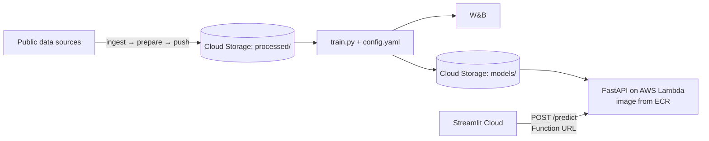

# Development Plan

*Living document. Review and finalize at the kickoff meeting, then update as plans change.*

**Team:** Haydn Stucker · Jothi TODO
**Due date:** Tuesday, November 24, 2026, 11:30 AM EST
**Kickoff:** TODO

---

## 1. Guiding Principles

1. **Build a walking skeleton first.** Get a trivial model running end to end as early as possible: cloud data → training → deployed API → Streamlit app. Deployment is where projects stall. Model quality isn't graded, so a dummy model that's deployed beats a great model sitting on a laptop.
2. **Config over code.** Paths, features, split ratios, and hyperparameters live in `config.yaml`. No magic numbers in scripts.
3. **One artifact for preprocessing + model.** Serialize a single sklearn `Pipeline` so the API applies exactly the transforms used in training.
4. **Agree on interfaces early so we can work in parallel.** Lock the feature list, config shape, and API request/response schema at kickoff (see [§5](#5-interface-contracts)).
5. **Everything through PRs.** Nobody pushes directly to `main`, and branch protection enforces it. The other partner reviews each PR. Commit messages follow Conventional Commits, enforced by commitlint.
6. **Never commit secrets.** Keys go in `.env` (gitignored), Streamlit Secrets, or the cloud platform's secret settings.

## 2. Kickoff Meeting Agenda

Goal: leave the meeting with every decision below made, owners assigned, and dates filled in.

| # | Decision | Proposed default | Notes |
|---|---|---|---|
| 1 | **Dataset & problem** | TODO | Pick using the criteria in [§3](#3-choosing-a-dataset) |
| 2 | Task type, target, metric | TODO | Write down the baseline we'll compare against |
| 3 | **Cloud provider** | ✅ **Google Cloud Storage + AWS Lambda** (revised Nov 14) | **Cloud Storage** (project `climate-impact-pipeline`) stores the data and models. The API runs on **Lambda** as a container image (stored in **ECR**) behind a public **Function URL**, and loads the model from the public bucket, so it holds no cloud keys. Lambda's always-free allowance (1M requests a month) covers a class demo, and Cloud Storage's free tier covers 5 GB in `us-east1`. Ruled out: App Runner (closed to new customers since Apr 30, 2026), Supabase (pauses after a week idle, 50 MB file cap, can't run containers), Firebase Storage (needs a billing account), and Cloud SQL (no free tier) |
| 4 | Data storage | ✅ **One Cloud Storage bucket, versioning on** (`climate-impact-pipeline-data`, `us-east1`) | `raw/` holds the snapshots, `processed/` the cleaned table, and `models/` the trained models. The whole bucket is publicly readable (uniform bucket-level access), so graders can rerun training without our credentials and the Lambda loads the model without Google keys. The data is public anyway; the models are public too. With versioning on, every pushed file keeps its earlier versions |
| 5 | Experiment tracker | ✅ **Weights & Biases** | Hosted dashboard that both of us (and graders, if the project is public) can see without running a server. Free academic plan (Pro features, 200 GB) with a duke.edu email. W&B is now part of CoreWeave Forge, but the `wandb` SDK is unchanged. Alternative considered: MLflow, which works offline but needs a hosted tracking server (or DagsHub) to share runs |
| 6 | Model | **scikit-learn RandomForest or XGBoost** | Keep a logistic/linear regression baseline for comparison |
| 7 | API framework | **FastAPI** | Pydantic validation and Swagger docs at `/docs` for free |
| 8 | Front-end | **Streamlit on Streamlit Community Cloud** | Deploys from the GitHub repo. Alternative: Gradio on Hugging Face Spaces |
| 9 | Model delivery to API | **Load from Cloud Storage at startup** (`MODEL_URI=gs://climate-impact-pipeline-data/models/latest/model.joblib`) | Keeps the image independent of the model. Lambda can only write to `/tmp`, so download the model there. Fallback: copy `model.joblib` into the image at build time |
| 10 | Cloud account & billing owner | TODO | Whose AWS account? Give each of us our own login (IAM Identity Center or an IAM user, never the root user). Set a budget alert. New accounts get up to $200 in credits on a 6-month Free plan, and AWS closes the account when it ends unless we upgrade. Upgrade before then if we reuse this pipeline in Spring 2027 |
| 11 | Work split & owners | See [§7](#7-work-split) | |
| 12 | Communication & cadence | TODO | e.g. a short async check-in every 2–3 days, a sync before integration |
| 13 | Milestone dates | See [§6](#6-milestones--tasks) | Work backward from the due date |

## 3. Choosing a Dataset

**Criteria.** These matter more than how interesting the data is:

- **Public, with a license that allows reuse.** Kaggle, UCI, or Hugging Face Datasets.
- **Tabular, with a clear supervised target.** Classification or regression.
- **Small: under ~100 MB and roughly 1k–500k rows.** Fast to train, cheap to store, and trains in seconds inside Docker.
- **5–15 features a human can understand and type into a form.** This matters a lot for the front-end: the UI has to collect inputs from a user. Features like "hour of day" or "neighborhood" work. Features like "mean concave points of cell nucleus" don't.
- **Some cleaning to do.** The assignment asks us to clean and preprocess, so a little mess is fine, even good.
- **Something to say about ethics.** The README needs a thoughtful ethics and limitations section.

**Candidates to discuss** (starting points only, bring your own):

| Dataset | Task | Target | UI-friendliness | Notes |
|---|---|---|---|---|
| [UCI Bike Sharing](https://archive.ics.uci.edu/dataset/275/bike+sharing+dataset) | Regression | Hourly rental count | ⭐⭐⭐ (season, hour, weather, temp) | Clean and intuitive. "How busy will it be?" |
| [UCI Adult / Census Income](https://archive.ics.uci.edu/dataset/2/adult) | Classification | Income > $50K | ⭐⭐⭐ | Classic. Rich ethics discussion (sex and race attributes, 1994 data) |
| [Inside Airbnb](https://insideairbnb.com/get-the-data/) (one city) | Regression | Nightly price | ⭐⭐⭐ (neighborhood, room type, bedrooms) | Messy, which is good cleaning practice. Pick one city to keep it small |
| [UCI Online Shoppers Intention](https://archive.ics.uci.edu/dataset/468/online+shoppers+purchasing+intention+dataset) | Classification | Purchase (yes/no) | ⭐⭐ | Imbalanced target, which makes metric choice interesting |
| [UCI Student Performance](https://archive.ics.uci.edu/dataset/320/student+performance) | Regression / classification | Final grade | ⭐⭐⭐ | Small (~650 rows). Fairness questions about predicting students |
| [UCI Wine Quality](https://archive.ics.uci.edu/dataset/186/wine+quality) | Regression / classification | Quality score | ⭐ (chemistry features) | Very clean, but the UI inputs are unintuitive |

## 4. Proposed Architecture & Stack



| Layer | Tool |
|---|---|
| Language | Python 3.12 |
| Data | pandas, requests (web APIs), google-cloud-storage |
| ML | scikit-learn (+ XGBoost, optional) |
| Config | YAML (`pyyaml`), optionally validated with Pydantic |
| Tracking | Weights & Biases |
| Serving | FastAPI + Uvicorn, run on Lambda through the [AWS Lambda Web Adapter](https://github.com/awslabs/aws-lambda-web-adapter) |
| Container | Docker (one image, `train` / `serve` entry points) |
| Cloud | Google Cloud: Cloud Storage (data and models). AWS: ECR (container images) and Lambda with a Function URL (API) |
| Front-end | Streamlit + `requests`, hosted on Streamlit Community Cloud |
| Tests | pytest, FastAPI `TestClient` |
| Local environment | PyDev: a Python 3.12 venv built from `requirements-pydev.txt` with `make venv` |
| Code style | ruff, configured in `pyproject.toml`. `make pr-ready` before every PR |
| CI & conventions | GitHub Actions, commitlint, pre-commit (ruff) |

The proposed repo layout is in the [README](../README.md#project-structure).

## 5. Interface Contracts

Lock these down at kickoff so Track A and Track B can build at the same time without blocking each other.

**Feature list.** Freeze the exact input columns, their types, and allowed values (category levels, numeric ranges). This list drives `config.yaml`, the Pydantic schema, and the Streamlit form.

**`config.yaml` shape.** See the [README](../README.md#configuration). Track A owns it, but both of us read it.

**API contract.**

```
GET  /health    → 200 {"status": "ok", "model_version": "<wandb-run-id>"}

GET  /metadata  → 200 {"model_version", "task", "target", "model_type", "metrics",
                       "features": [{"name", "kind", "min", "max"} | {"name", "kind", "categories"}],
                       "classes", "example", ...}

POST /predict   → body: one JSON object with one key per feature
                ← 200 {"prediction": <label or number>,
                       "probability": <float | null>,   # predicted class; classification only
                       "model_version": "<wandb-run-id>"}
                ← 422 on validation errors: missing, extra, or wrongly typed fields,
                      or a category not seen in training
```

The `/predict` request schema is generated from the model's `metadata.json`, so the API code doesn't change when the feature list does. The Streamlit form can do the same by reading `/metadata`.

**Model artifact.** A single `model.joblib` holding the full sklearn `Pipeline`, stored at `gs://climate-impact-pipeline-data/models/<run-id>/model.joblib` with a copy at `gs://climate-impact-pipeline-data/models/latest/model.joblib`. A `metadata.json` sits next to it: run ID, timestamp, task, metrics, features (numeric ranges, allowed categories), class labels, an example request, the data file's SHA-256, library versions, and the full config.

## 6. Milestones & Tasks

**Proposed schedule** (worked backward from the deadline; confirm at kickoff):

| Milestone | Target |
|---|---|
| M0: Kickoff & setup | Sat, Nov 7 |
| Walking skeleton: stub model deployed and called by the live app | Thu, Nov 12 |
| Phase 1 complete (both tracks) | Sun, Nov 15 |
| Phase 2: Integration | Wed, Nov 18 |
| Phase 3: Docs, ethics, polish | Sat, Nov 21 |
| Buffer for surprises | Sun, Nov 22 – Mon, Nov 23 |
| **Submit** (aim for the night before) | **Tue, Nov 24, 11:30 AM EST** |

### M0: Kickoff & repo setup *(together)* · Target: Sat, Nov 7

- [ ] Make every decision in [§2](#2-kickoff-meeting-agenda)
- [x] Invite Jothi as a repo collaborator with write access. **Jothi: accept the invite** so your reviews count toward branch protection
- [x] Protect `main` with a ruleset: PR required, 1 approval, **CI passed** check, no bypass
- [x] Add commitlint (local hook + CI), pre-commit (gitleaks, ruff, file checks), the CI workflow, a PR template, and `.gitignore`
- [x] Squash-merge only, auto-delete merged branches, CODEOWNERS, Dependabot, and secret scanning with push protection
- [x] PyDev environment (`make venv`), shared ruff style (`pyproject.toml`), and `make pr-ready`
- [ ] Jothi: run `make venv`, `source PyDev/bin/activate`, and `make setup`
- [ ] Set up the AWS account: billing, a budget alert, and a login for each of us (see decision 10)
- [x] Create the Cloud Storage bucket `climate-impact-pipeline-data` (`us-east1`, versioning on, public read)
- [ ] Create the ECR repository in our AWS region
- [ ] Apply for the W&B academic plan with a duke.edu email, create a team, invite Jothi, and create a **public** project
- [x] Scaffold the code layout: folders, `.env.example`, `config.yaml`, `requirements.txt` (plus the dataset-agnostic framework; see Phase 1)

### Phase 1: Parallel build · Target: Sun, Nov 15 (walking skeleton by Thu, Nov 12)

> **Framework status (Nov 7, `pipeline-tooling` branch).** The parts of these tasks that don't depend on the dataset are built and tested on a synthetic demo dataset: config loading and validation, cloud storage, data loading and splitting, preprocessing, the model registry, metrics and plots, W&B logging, the training CLI, the FastAPI app, the Dockerfile and entrypoint, and a Docker smoke test in CI. What's left in each task is dataset-specific:
>
> | Task | Remaining |
> |---|---|
> | A1 | All of it (EDA) |
> | A2 | The three-stage data pipeline is built (`data-pipeline` branch, Nov 14). Add the real sources to `config.yaml`, write their cleaners and feature steps in `src/prepare.py`, then run `make data` |
> | A3, A4 | Set the real feature lists and target in `config.yaml`. Add tests for any dataset-specific preprocessing |
> | A5–A7 | Pick the metric and baseline, run the experiments, fill in the results table |
> | B1, B2 | Replace `tests/sample_request.json` with a real record |
> | B3 | Built. Confirm `make docker-smoke` passes (locally or in CI), then again with the real config |
> | B4–B6 | All of it (deploy, front-end) |
>
> Re-split ownership at kickoff so each of us still has PRs to open.

#### Track A: Data & training pipeline

| ID | Task | Done when | Owner | PR |
|---|---|---|---|---|
| A1 | EDA notebook: understand the data, find cleaning needs, check for target leakage | Short findings written in the notebook | | |
| A2 | `scripts/ingest_data.py`, `prepare_data.py`, `push_data.py`: fetch raw data from APIs → clean, join, and add features → upload the processed table to Cloud Storage under `processed/` | Processed file is in Cloud Storage. Scripts are re-runnable | | |
| A3 | `src/config.py` + `src/data.py`: load config, download processed data from Cloud Storage with google-cloud-storage (add it to `requirements.txt`). Read anonymously, since the bucket is public, so graders can run it | `python -c` smoke test loads a DataFrame, with and without Google credentials | | |
| A4 | `src/features.py`: `ColumnTransformer` (impute, scale, encode) driven by the feature lists in config | Unit test passes on a small sample | | |
| A5 | `src/train.py` + `src/evaluate.py`: train/val/test split (seeded), train the model from config, compute metrics, save `model.joblib` + `metadata.json` locally and to Cloud Storage (`models/<run-id>/` and `models/latest/`). Skip the upload, with a warning, when no Google credentials are set | Baseline and main model both train from config | | |
| A6 | W&B integration: log config, metrics, confusion matrix / residual plot, feature importance, and the model as a W&B artifact (upload the file, or add a `gs://` reference). Honor `WANDB_MODE=offline` / `disabled` so anyone can train without a W&B account | Runs appear on the dashboard with plots and the artifact. Training also runs with `WANDB_MODE=disabled` | | |
| A7 | Run 3–5 experiments (different models or hyperparameters) and pick the final model | Results table in the README links to the runs | | |

#### Track B: Serving, deployment & front-end

| ID | Task | Done when | Owner | PR |
|---|---|---|---|---|
| B1 | `api/schemas.py` + `api/main.py`: FastAPI with `/health` and `/predict`, loading a model from `MODEL_URI` (a local path, or a `gs://` URI downloaded to `/tmp`, the only writable folder on Lambda). Start with a **stub model** trained quickly on the raw data | `curl` against localhost returns a prediction | | |
| B2 | `tests/test_api.py` + `tests/sample_request.json` | `pytest` passes | | |
| B3 | `Dockerfile` + `entrypoint.sh`: one image, `train` and `serve` commands, `serve` is the default and listens on `$PORT` (8080). Copy in the [AWS Lambda Web Adapter](https://github.com/awslabs/aws-lambda-web-adapter) so the same image runs on Lambda, and set `AWS_LWA_READINESS_CHECK_PATH=/health` | `docker run ... train` and `docker run -p 8080:8080 ... serve` both work locally | | |
| B4 | Deploy the API to AWS Lambda: push the image to ECR, create the function from it (about 2 GB memory, 30 s timeout), set `MODEL_URI` to the model in the public bucket, and add a public Function URL (auth type `NONE`). Steps are in README §Usage 5 | The Function URL answers `/predict` via `curl` | | |
| B5 | `frontend/app.py`: Streamlit form for the frozen feature list → `requests.post` to `API_URL` → show the prediction, confidence, and a short explanation and disclaimer. Handle API errors and timeouts | Works locally against both the local API and the deployed API | | |
| B6 | Deploy the front-end to Streamlit Community Cloud with `API_URL` set in Secrets | Public link works in an incognito window | | |

> **Walking-skeleton checkpoint:** by the end of Phase 1 the stub model should be served from Lambda and called by the deployed Streamlit app, even if Track A's real model isn't finished.

### Phase 2: Integration *(together)* · Target: Wed, Nov 18

- [ ] Point the deployed API's `MODEL_URI` at the real model in Cloud Storage and redeploy
- [ ] End-to-end test: run training in Docker → model lands in Cloud Storage → redeploy → front-end shows the new `model_version`
- [ ] Do a fresh-clone reproducibility test: one of us follows the README from scratch on a clean machine or folder
- [ ] Improve the front-end: input validation, sensible defaults, maybe a chart (probability bar, feature importance) to make it interactive and intuitive

### Phase 3: Documentation, ethics & submission *(together)* · Target: Sat, Nov 21

- [ ] Fill in every **TODO** in the README: dataset, metric, results, links to the live app, API, and W&B
- [ ] Write the ethics & limitations section (questions are in the README)
- [ ] Check the requirements list ([§10](#10-requirements-checklist)). Every box ticked
- [ ] Clean up commit history and branches. Confirm both of us have merged PRs
- [ ] Confirm the deployed app and API are still live on submission day
- [ ] Submit by **Tue, Nov 24, 11:30 AM EST**

### Stretch (optional): Go inference service

Only after everything above is done, and never at the deadline's expense. See the README's [Python vs. Go](../README.md#language-choice-python-vs-go) comparison for why this is the best-fit way to learn Go here.

| ID | Task | Done when |
|---|---|---|
| S1 | Export the trained scikit-learn pipeline to ONNX (`skl2onnx`). Check that its predictions match the joblib model's | Predictions match on the test set |
| S2 | Go `net/http` service that serves the same `/predict` contract with ONNX Runtime (`onnxruntime_go`), in its own Dockerfile | `curl` returns the same predictions as the FastAPI service |
| S3 | Deploy it next to the FastAPI service and load-test both with `hey` or k6 | Latency, throughput, memory, image size, and cold start recorded in the README |

## 7. Work Split

Proposal: each of us **owns** one track and **reviews** the other's PRs. To make sure we both learn the cloud side, consider swapping one task each (e.g., the Track A owner does B6, the Track B owner does A6).

| Area | Primary owner | Reviewer |
|---|---|---|
| Track A: data & pipeline | TODO | TODO |
| Track B: serving, deploy, front-end | TODO | TODO |
| README & ethics | Shared | Shared |

**PR requirement:** each member must submit at least one PR. With this split we'll each have many more, which is good. It also gives us a clear commit history.

## 8. Git Workflow

The README's [Contributing](../README.md#contributing) section describes the tooling. In short:

**Branches.** Short-lived branches off `main`, one per task, prefixed with the commit type:

```
feat/a2-upload-data
feat/b3-dockerfile
fix/api-missing-field-422
docs/readme-results
```

**Commits.** [Conventional Commits](https://www.conventionalcommits.org/), enforced by commitlint through a local `commit-msg` hook and again in CI. Examples: `feat(data): add download helper`, `fix(pipeline): stratify split for small classes`. Run `pre-commit install` once after cloning.

**Pull requests.**

- Run `make pr-ready PR_TITLE="..."` before opening the PR. It runs the same checks as CI
- Give the PR a Conventional Commit title. CI lints it
- Link the task ID (e.g., "Implements A5") and describe how you tested it. The [PR template](../.github/pull_request_template.md) prompts for both
- Keep PRs small, ideally reviewable in under 15 minutes
- CODEOWNERS automatically requests your partner's review. Branch protection on `main` requires **1 approval** and a green **CI passed** check before merging. New pushes dismiss earlier approvals
- **Squash and merge** is the only option. The PR title becomes the commit on `main`, and the branch is deleted automatically
- Dependabot PRs (weekly) need a review too. Skim the changelog, and merge if CI is green

**CI grows with the project.** Add jobs to [`.github/workflows/ci.yml`](../.github/workflows/ci.yml) as each phase lands, and list each one under `ci-passed.needs`. Branch protection only requires the `CI passed` gate, so it never needs updating:

| Phase | Add to CI |
|---|---|
| Now | commitlint (commits + PR title), gitleaks secret scan, pre-commit hooks (file checks, ruff), pytest (config, features, models, storage, training, API), and a Docker smoke test (build, train on demo data, serve read-only, call `/health` and `/predict`) |
| Track A | Tests for dataset-specific cleaning and preprocessing (picked up by the existing pytest job) |
| Track B | Front-end tests, if any. The API tests and Docker check already run |
| Deploy | CD job: on push to `main`, build the image, push it to ECR, and update the Lambda function. Sign in to AWS with a GitHub OIDC role instead of stored AWS keys. Streamlit Community Cloud redeploys from `main` on its own |

**Changing branch protection.** Edit [`.github/rulesets/protect-main.json`](../.github/rulesets/protect-main.json) in a PR. Once it merges, a repo admin applies it:

```bash
RULESET_ID=$(gh api repos/haydn-s/sourcing-data-project-3/rulesets --jq '.[] | select(.name == "Protect main") | .id')
gh api -X PUT "repos/haydn-s/sourcing-data-project-3/rulesets/$RULESET_ID" --input .github/rulesets/protect-main.json
```

## 9. Risks & Mitigations

| Risk | Mitigation |
|---|---|
| Cloud deployment takes much longer than expected | Walking skeleton in Phase 1. Deploy the stub model early |
| Lambda rejects or can't run the image: `exec format error` (an Apple Silicon build) or "The image manifest, config or layer media type ... is not supported" (buildx attestations) | Build for one platform without attestations: `docker buildx build --platform linux/amd64 --provenance=false --sbom=false`. Set the function's architecture to `x86_64` to match |
| Function URL returns 403 Forbidden | Since October 2025, a public Function URL needs both `lambda:InvokeFunctionUrl` and `lambda:InvokeFunction` in the function's resource policy. The console adds both when you choose auth type `NONE`. With the CLI, add each one yourself |
| Slow Lambda cold start | The first request after idle loads scikit-learn and downloads the model. Give the function about 2 GB of memory (which also gives it more CPU), keep torch and TensorFlow out of the image, and give the Streamlit request a generous timeout |
| Credentials leak into git | `.gitignore` covers `.env` and key files. gitleaks runs on commit and in CI, and GitHub push protection checks every push. The Lambda reads the public bucket, so it holds no cloud keys, and CI should sign in with GitHub OIDC (Workload Identity Federation on Google Cloud) instead of stored keys. If a key leaks, rotate it first |
| Surprise cloud bill | Budget alerts on both accounts. Lambda scales to zero and its always-free allowance covers our traffic. Downloads from the public bucket are billed to us, but the files are small. Tear down after grading |
| Someone skips the local hooks (`git commit --no-verify`) | CI re-runs commitlint and the pre-commit hooks on every PR, and branch protection blocks the merge until they pass |
| Required review stalls merging when one of us is busy | Keep PRs small. Agree at kickoff to review within a day |
| Training/serving skew (API transforms differ from training) | Serialize one sklearn `Pipeline`. The API never re-implements preprocessing |
| Front-end can't reach the API (CORS / timeouts) | Streamlit calls the API server-side through `requests`, so CORS doesn't apply. Add a timeout and a friendly error message. The first request after idle can be slow (cold start) |
| Partner schedules don't line up | Interfaces frozen at kickoff, so each track can work independently. Async updates in our chat |
| Graders can't reproduce training | README tested from a fresh clone. Processed data publicly readable (or a documented fallback to the original source) |

## 10. Requirements Checklist

Maps each assignment requirement to where we satisfy it. Tick these off before submitting.

**Repository**

- [ ] Code for preprocessing, training, serving, and deployment → `scripts/`, `src/`, `api/`, `Dockerfile`
- [ ] `config.yaml` controls pipeline parameters
- [ ] `requirements.txt`
- [ ] `Dockerfile` that runs the full project, with `train` and `serve` entry points
- [ ] Docs: how to train → README §Usage 2
- [ ] Docs: how to build and test the API locally → README §Usage 3–4
- [ ] Docs: how to deploy to the cloud → README §Usage 5–6
- [ ] Experiment tracking logs parameters, metrics, and artifacts (model, plots)
- [ ] Branches and PRs, with ≥1 PR from each member
- [ ] Clear project structure and commit history

**Pipeline**

- [ ] Data cleaned locally and uploaded to cloud storage
- [ ] Script downloads data from the cloud programmatically
- [ ] Preprocessing / feature engineering
- [ ] Train / validation / test split
- [ ] Training + evaluation with a defined metric

**API**

- [ ] FastAPI loads the trained model
- [ ] `/predict` accepts JSON and returns a prediction
- [ ] Tested locally with curl / Postman
- [ ] Deployed to the cloud platform and publicly reachable
- [ ] Confirmed working via an HTTP request with test data

**Front-end**

- [ ] Built with Streamlit (or Gradio)
- [ ] Publicly hosted and linked in the README
- [ ] Sends requests to the deployed API
- [ ] Displays predictions in an interactive, intuitive way

**README**

- [ ] Project overview and goals
- [ ] Dataset description and link
- [ ] Model architecture and evaluation
- [ ] Cloud services used
- [ ] Setup and usage instructions
- [ ] Links to the deployed API and front-end
- [ ] Ethics and limitations reflection
