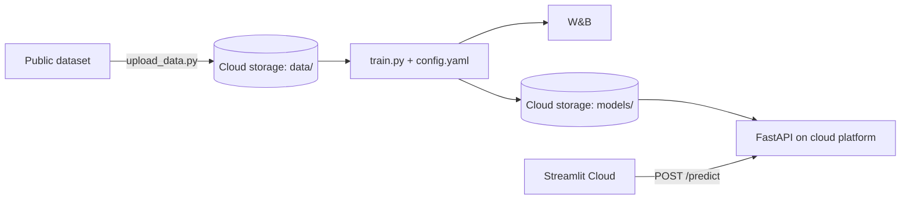

# Development Plan

*Living document. Review and finalize at the kickoff meeting, then update as plans change.*

**Team:** Haydn Stucker · Jothi TODO
**Due date:** TODO
**Kickoff:** TODO

---

## 1. Guiding Principles

1. **Build a walking skeleton first.** Get a trivial model running end to end as early as possible: cloud data → training → deployed API → Streamlit app. Deployment is where projects stall. Model quality isn't graded, so a dummy model that's deployed beats a great model sitting on a laptop.
2. **Config over code.** Paths, features, split ratios, and hyperparameters live in `config.yaml`. No magic numbers in scripts.
3. **One artifact for preprocessing + model.** Serialize a single sklearn `Pipeline` so the API applies exactly the transforms used in training.
4. **Agree on interfaces early so we can work in parallel.** Lock the feature list, config shape, and API request/response schema at kickoff (see [§5](#5-interface-contracts)).
5. **Everything through PRs.** Nobody pushes directly to `main`, and branch protection enforces it. The other partner reviews each PR. Commit messages follow Conventional Commits, enforced by commitlint.
6. **Never commit secrets.** Keys go in `.env` (gitignored), Streamlit Secrets, or the cloud platform's secret settings.

## 2. Kickoff Meeting Agenda

Goal: leave the meeting with every decision below made, owners assigned, and dates filled in.

| # | Decision | Proposed default | Notes |
|---|---|---|---|
| 1 | **Dataset & problem** | TODO | Pick using the criteria in [§3](#3-choosing-a-dataset) |
| 2 | Task type, target, metric | TODO | Write down the baseline we'll compare against |
| 3 | **Cloud provider** | TODO (not GCP) | Needs cloud storage for the data and a platform that serves our container at a public URL. Options from the assignment: AWS (S3 + Lambda with API Gateway), Azure Functions, Supabase (Postgres) for storage |
| 4 | Data storage | TODO | Consider making the *processed* data publicly readable (the data is public anyway) so graders can rerun training without our credentials |
| 5 | Experiment tracker | **Weights & Biases** | Hosted dashboard that both of us (and graders, if the project is public) can see without running a server. Alternative: MLflow, which works offline but needs a hosted tracking server (or DagsHub) to share runs |
| 6 | Model | **scikit-learn RandomForest or XGBoost** | Keep a logistic/linear regression baseline for comparison |
| 7 | API framework | **FastAPI** | Pydantic validation and Swagger docs at `/docs` for free |
| 8 | Front-end | **Streamlit on Streamlit Community Cloud** | Deploys from the GitHub repo. Alternative: Gradio on Hugging Face Spaces |
| 9 | Model delivery to API | **Load from cloud storage at startup** (`MODEL_URI`) | Keeps the image independent of the model. Fallback: copy `model.joblib` into the image at build time |
| 10 | Cloud account & billing owner | TODO | Whose account? Give the other person access. Set a budget alert |
| 11 | Work split & owners | See [§7](#7-work-split) | |
| 12 | Communication & cadence | TODO | e.g. a short async check-in every 2–3 days, a sync before integration |
| 13 | Milestone dates | See [§6](#6-milestones--tasks) | Work backward from the due date |

## 3. Choosing a Dataset

**Criteria.** These matter more than how interesting the data is:

- **Public, with a license that allows reuse.** Kaggle, UCI, or Hugging Face Datasets.
- **Tabular, with a clear supervised target.** Classification or regression.
- **Small: under ~100 MB and roughly 1k–500k rows.** Fast to train, cheap to store, and trains in seconds inside Docker.
- **5–15 features a human can understand and type into a form.** This matters a lot for the front-end: the UI has to collect inputs from a user. Features like "hour of day" or "neighborhood" work. Features like "mean concave points of cell nucleus" don't.
- **Some cleaning to do.** The assignment asks us to clean and preprocess, so a little mess is fine, even good.
- **Something to say about ethics.** The README needs a thoughtful ethics and limitations section.

**Candidates to discuss** (starting points only, bring your own):

| Dataset | Task | Target | UI-friendliness | Notes |
|---|---|---|---|---|
| [UCI Bike Sharing](https://archive.ics.uci.edu/dataset/275/bike+sharing+dataset) | Regression | Hourly rental count | ⭐⭐⭐ (season, hour, weather, temp) | Clean and intuitive. "How busy will it be?" |
| [UCI Adult / Census Income](https://archive.ics.uci.edu/dataset/2/adult) | Classification | Income > $50K | ⭐⭐⭐ | Classic. Rich ethics discussion (sex and race attributes, 1994 data) |
| [Inside Airbnb](https://insideairbnb.com/get-the-data/) (one city) | Regression | Nightly price | ⭐⭐⭐ (neighborhood, room type, bedrooms) | Messy, which is good cleaning practice. Pick one city to keep it small |
| [UCI Online Shoppers Intention](https://archive.ics.uci.edu/dataset/468/online+shoppers+purchasing+intention+dataset) | Classification | Purchase (yes/no) | ⭐⭐ | Imbalanced target, which makes metric choice interesting |
| [UCI Student Performance](https://archive.ics.uci.edu/dataset/320/student+performance) | Regression / classification | Final grade | ⭐⭐⭐ | Small (~650 rows). Fairness questions about predicting students |
| [UCI Wine Quality](https://archive.ics.uci.edu/dataset/186/wine+quality) | Regression / classification | Quality score | ⭐ (chemistry features) | Very clean, but the UI inputs are unintuitive |

## 4. Proposed Architecture & Stack



| Layer | Tool |
|---|---|
| Language | Python 3.11 |
| Data | pandas + the cloud provider's SDK (TBD) |
| ML | scikit-learn (+ XGBoost, optional) |
| Config | YAML (`pyyaml`), optionally validated with Pydantic |
| Tracking | Weights & Biases |
| Serving | FastAPI + Uvicorn |
| Container | Docker (one image, `train` / `serve` entry points) |
| Cloud | TODO: storage + API hosting |
| Front-end | Streamlit + `requests`, hosted on Streamlit Community Cloud |
| Tests | pytest, FastAPI `TestClient` |
| CI & conventions | GitHub Actions, commitlint, pre-commit (ruff) |

The proposed repo layout is in the [README](../README.md#project-structure).

## 5. Interface Contracts

Lock these down at kickoff so Track A and Track B can build at the same time without blocking each other.

**Feature list.** Freeze the exact input columns, their types, and allowed values (category levels, numeric ranges). This list drives `config.yaml`, the Pydantic schema, and the Streamlit form.

**`config.yaml` shape.** See the [README](../README.md#configuration). Track A owns it, but both of us read it.

**API contract.**

```
GET  /health   → 200 {"status": "ok", "model_version": "<wandb-run-id>"}

POST /predict  → body: one JSON object with one key per feature
               ← 200 {"prediction": <label or number>,
                      "probability": <float | null>,   # classification only
                      "model_version": "<wandb-run-id>"}
               ← 422 on validation errors (FastAPI default)
```

**Model artifact.** A single `model.joblib` holding the full sklearn `Pipeline`, stored at `<cloud-storage>/models/<run-id>/model.joblib` with a copy at `<cloud-storage>/models/latest/model.joblib`. A small `metadata.json` sits next to it (feature list, metrics, run ID, timestamp).

## 6. Milestones & Tasks

Fill in target dates at kickoff, working backward from the due date. Leave a buffer of at least 2–3 days before the deadline for integration problems and documentation.

### M0: Kickoff & repo setup *(together)* · Target: TODO

- [ ] Make every decision in [§2](#2-kickoff-meeting-agenda)
- [x] Invite Jothi as a repo collaborator with write access. **Jothi: accept the invite** so your reviews count toward branch protection
- [x] Protect `main` with a ruleset: PR required, 1 approval, **CI passed** check, no bypass
- [x] Add commitlint (local hook + CI), pre-commit (ruff), the CI workflow, a PR template, and `.gitignore`
- [ ] Set up the cloud account (provider TBD) with billing, a budget alert, and access for both of us
- [ ] Create the W&B project (team or public) and give both of us access
- [ ] Scaffold the code layout: folders, `.env.example`, empty `config.yaml`, `requirements.txt`

### Phase 1: Parallel build

#### Track A: Data & training pipeline

| ID | Task | Done when | Owner | PR |
|---|---|---|---|---|
| A1 | EDA notebook: understand the data, find cleaning needs, check for target leakage | Short findings written in the notebook | | |
| A2 | `scripts/upload_data.py`: download raw data → clean → upload processed CSV/Parquet to cloud storage | Processed file is in cloud storage. Script is re-runnable | | |
| A3 | `src/config.py` + `src/data.py`: load config, download processed data from cloud storage | `python -c` smoke test loads a DataFrame | | |
| A4 | `src/features.py`: `ColumnTransformer` (impute, scale, encode) driven by the feature lists in config | Unit test passes on a small sample | | |
| A5 | `src/train.py` + `src/evaluate.py`: train/val/test split (seeded), train the model from config, compute metrics, save `model.joblib` + `metadata.json` locally and to cloud storage | Baseline and main model both train from config | | |
| A6 | W&B integration: log config, metrics, confusion matrix / residual plot, feature importance, and the model as a W&B artifact | Runs appear on the dashboard with plots and the artifact | | |
| A7 | Run 3–5 experiments (different models or hyperparameters) and pick the final model | Results table in the README links to the runs | | |

#### Track B: Serving, deployment & front-end

| ID | Task | Done when | Owner | PR |
|---|---|---|---|---|
| B1 | `api/schemas.py` + `api/main.py`: FastAPI with `/health` and `/predict`, loading a model from `MODEL_URI` (local path or cloud storage URI). Start with a **stub model** trained quickly on the raw data | `curl` against localhost returns a prediction | | |
| B2 | `tests/test_api.py` + `tests/sample_request.json` | `pytest` passes | | |
| B3 | `Dockerfile` + `entrypoint.sh`: one image, `train` and `serve` commands, `serve` is the default and listens on `$PORT` | `docker run ... train` and `docker run -p 8080:8080 ... serve` both work locally | | |
| B4 | Deploy the API to the cloud platform (TBD): push the image to its registry, deploy it as a public HTTPS service, and give it read access to the model in cloud storage | Public URL answers `/predict` via `curl` | | |
| B5 | `frontend/app.py`: Streamlit form for the frozen feature list → `requests.post` to `API_URL` → show the prediction, confidence, and a short explanation and disclaimer. Handle API errors and timeouts | Works locally against both the local API and the deployed API | | |
| B6 | Deploy the front-end to Streamlit Community Cloud with `API_URL` set in Secrets | Public link works in an incognito window | | |

> **Walking-skeleton checkpoint:** by the end of Phase 1 the stub model should be served from the cloud platform and called by the deployed Streamlit app, even if Track A's real model isn't finished.

### Phase 2: Integration *(together)* · Target: TODO

- [ ] Point the deployed API's `MODEL_URI` at the real model in cloud storage and redeploy
- [ ] End-to-end test: run training in Docker → model lands in cloud storage → redeploy → front-end shows the new `model_version`
- [ ] Do a fresh-clone reproducibility test: one of us follows the README from scratch on a clean machine or folder
- [ ] Improve the front-end: input validation, sensible defaults, maybe a chart (probability bar, feature importance) to make it interactive and intuitive

### Phase 3: Documentation, ethics & submission *(together)* · Target: TODO

- [ ] Fill in every **TODO** in the README: dataset, metric, results, links to the live app, API, and W&B
- [ ] Write the ethics & limitations section (questions are in the README)
- [ ] Check the requirements list ([§10](#10-requirements-checklist)). Every box ticked
- [ ] Clean up commit history and branches. Confirm both of us have merged PRs
- [ ] Confirm the deployed app and API are still live on submission day
- [ ] Submit

## 7. Work Split

Proposal: each of us **owns** one track and **reviews** the other's PRs. To make sure we both learn the cloud side, consider swapping one task each (e.g., the Track A owner does B6, the Track B owner does A6).

| Area | Primary owner | Reviewer |
|---|---|---|
| Track A: data & pipeline | TODO | TODO |
| Track B: serving, deploy, front-end | TODO | TODO |
| README & ethics | Shared | Shared |

**PR requirement:** each member must submit at least one PR. With this split we'll each have many more, which is good. It also gives us a clear commit history.

## 8. Git Workflow

The README's [Contributing](../README.md#contributing) section describes the tooling. In short:

**Branches.** Short-lived branches off `main`, one per task, prefixed with the commit type:

```
feat/a2-upload-data
feat/b3-dockerfile
fix/api-missing-field-422
docs/readme-results
```

**Commits.** [Conventional Commits](https://www.conventionalcommits.org/), enforced by commitlint through a local `commit-msg` hook and again in CI. Examples: `feat(data): add download helper`, `fix(pipeline): stratify split for small classes`. Run `pre-commit install` once after cloning.

**Pull requests.**

- Give the PR a Conventional Commit title. CI lints it
- Link the task ID (e.g., "Implements A5") and describe how you tested it. The [PR template](../.github/pull_request_template.md) prompts for both
- Keep PRs small, ideally reviewable in under 15 minutes
- Branch protection on `main` requires **1 approval from your partner** and a green **CI passed** check before merging. New pushes dismiss earlier approvals
- Delete the branch after merging

**CI grows with the project.** Add jobs to [`.github/workflows/ci.yml`](../.github/workflows/ci.yml) as each phase lands, and list each one under `ci-passed.needs`. Branch protection only requires the `CI passed` gate, so it never needs updating:

| Phase | Add to CI |
|---|---|
| Now | commitlint (commits + PR title), pre-commit hooks (ruff), pytest |
| Track A | Unit tests for config loading and `features.py` (picked up by the existing pytest job) |
| Track B | API tests with FastAPI `TestClient`. A Docker build check (`docker build`, then smoke-test `/health`) |
| Deploy | CD job: on push to `main`, build and deploy the API to the cloud platform (provider TBD). Streamlit Community Cloud redeploys from `main` on its own |

**Changing branch protection.** Edit [`.github/rulesets/protect-main.json`](../.github/rulesets/protect-main.json) in a PR. Once it merges, a repo admin applies it:

```bash
RULESET_ID=$(gh api repos/haydn-s/sourcing-data-project-3/rulesets --jq '.[] | select(.name == "Protect main") | .id')
gh api -X PUT "repos/haydn-s/sourcing-data-project-3/rulesets/$RULESET_ID" --input .github/rulesets/protect-main.json
```

## 9. Risks & Mitigations

| Risk | Mitigation |
|---|---|
| Cloud deployment takes much longer than expected | Walking skeleton in Phase 1. Deploy the stub model early |
| Apple Silicon image fails on the cloud platform (`exec format error`) | Build with `docker buildx build --platform linux/amd64` |
| Credentials leak into git | `.gitignore` covers `.env` and key files. Prefer the platform's built-in service identity over long-lived keys |
| Surprise cloud bill | Budget alert. Free tiers and scale-to-zero where available. Small dataset. Tear down after grading |
| Someone skips the local hooks (`git commit --no-verify`) | CI re-runs commitlint and the pre-commit hooks on every PR, and branch protection blocks the merge until they pass |
| Required review stalls merging when one of us is busy | Keep PRs small. Agree at kickoff to review within a day |
| Training/serving skew (API transforms differ from training) | Serialize one sklearn `Pipeline`. The API never re-implements preprocessing |
| Front-end can't reach the API (CORS / timeouts) | Streamlit calls the API server-side through `requests`, so CORS doesn't apply. Add a timeout and a friendly error message. The first request after idle can be slow (cold start) |
| Partner schedules don't line up | Interfaces frozen at kickoff, so each track can work independently. Async updates in our chat |
| Graders can't reproduce training | README tested from a fresh clone. Processed data publicly readable (or a documented fallback to the original source) |

## 10. Requirements Checklist

Maps each assignment requirement to where we satisfy it. Tick these off before submitting.

**Repository**

- [ ] Code for preprocessing, training, serving, and deployment → `scripts/`, `src/`, `api/`, `Dockerfile`
- [ ] `config.yaml` controls pipeline parameters
- [ ] `requirements.txt`
- [ ] `Dockerfile` that runs the full project, with `train` and `serve` entry points
- [ ] Docs: how to train → README §Usage 2
- [ ] Docs: how to build and test the API locally → README §Usage 3–4
- [ ] Docs: how to deploy to the cloud → README §Usage 5–6
- [ ] Experiment tracking logs parameters, metrics, and artifacts (model, plots)
- [ ] Branches and PRs, with ≥1 PR from each member
- [ ] Clear project structure and commit history

**Pipeline**

- [ ] Data cleaned locally and uploaded to cloud storage
- [ ] Script downloads data from the cloud programmatically
- [ ] Preprocessing / feature engineering
- [ ] Train / validation / test split
- [ ] Training + evaluation with a defined metric

**API**

- [ ] FastAPI loads the trained model
- [ ] `/predict` accepts JSON and returns a prediction
- [ ] Tested locally with curl / Postman
- [ ] Deployed to the cloud platform and publicly reachable
- [ ] Confirmed working via an HTTP request with test data

**Front-end**

- [ ] Built with Streamlit (or Gradio)
- [ ] Publicly hosted and linked in the README
- [ ] Sends requests to the deployed API
- [ ] Displays predictions in an interactive, intuitive way

**README**

- [ ] Project overview and goals
- [ ] Dataset description and link
- [ ] Model architecture and evaluation
- [ ] Cloud services used
- [ ] Setup and usage instructions
- [ ] Links to the deployed API and front-end
- [ ] Ethics and limitations reflection
